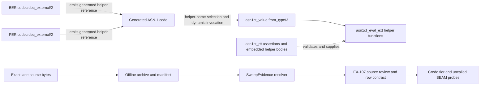

# Phase 01.1.1.17: Bound ASN.1 external-transform exclusions — Research

**Researched:** 2026-11-09  
**Domain:** Exact-lane OTP source review and static guard contracts  
**Confidence:** Medium overall; high for the allocated source identities, implementation boundaries, and repository patterns; low for semantic dispositions, which remain for the two independent lane reviews.

<user_constraints>
## User Constraints (from CONTEXT.md)

### Locked Decisions

- **D17-A:** Bind full-file source hashes and selected spans separately for core and floor in the already approved offline archive. Do not add recurring downloads, a dependency, or a competing source authority.
- **D17-B:** Preserve EX-107's complete current match sets and original `:pending` status. Store this two-function slice as bounded evidence connected losslessly to the original row. Leave every other match and prior bounded slice unchanged.
- **D17-C:** Trace both codec `dec_external/2` paths that emit generated helper calls, `asn1ct_value:from_type/3` helper-name selection and dynamic invocation, and `asn1ct_rtt` assertions plus embedded implementations. Distinguish generated-call evidence from ordinary Xref edges. Do not treat source names, a no-incoming-edge result, or fixed type names as a semantic verdict.
- **D17-D:** Review the complete selected helper functions and relevant caller/delegate paths on each exact lane. Every disposition must cite the exact lane source and account for whether caller-chosen input can reach atom creation. A retained matcher needs its own non-vacuous removal witness on each applicable lane. Do not infer a verdict for any other EX-107 match.
- **D17-E:** Do not execute the audited functions or atom-creation sinks. Static guard probes may compile but must keep audited calls in uncalled bodies. Make no product/runtime behavior change and no application-code change.
- **D17-F:** Keep delivery within the existing archive, `SweepEvidence`, EX-107 contract, Credo guard, and mirrored contract-test files. Reuse their existing patterns; add no general parser or taint-analysis framework.
- **D17-G:** Apply unchanged quality limits per slice: under 100,000 planning-context tokens including reserve, at most five exact source files per task, 2–3 tasks per plan, at most five plans in a phase, and roughly three working days per plan. This candidate is estimated at 5,498 selected source tokens plus a 19,500-token reserve (24,998 total), three tasks, one plan, and one to two working days at medium confidence. Record actual task intervals during execution. Re-size before widening if any limit is at risk.
- **D17-H:** Preserve all inherited Macro, changed-wording, source-authority, `lib/` collision, branch ownership, and delivery stop rules. Keep SEC-01 assigned to Phase 5 and leave the parent aggregate and Phase 2 gate open.

### the agent's Discretion

The phase context lists no separate discretion items. The approved boundaries and existing patterns define the implementation choices.

### Deferred Ideas (OUT OF SCOPE)

All EX-107 matches outside the two selected functions, floor `user:start/0` source recovery, full-remainder family estimates, complete Phase 01.1.1.1 closure, SEC-01, and Phase 2 remain open. Continue rolling allocation for other source-complete slices without implying that this phase resolves them.
</user_constraints>

## Summary

Plan one bounded, three-task delivery: bind/review five exact core source files, bind/review their five exact floor counterparts, then integrate lane-specific review records and omission-sensitive controls into the current archive/resolver, EX-107 contract, Credo tier, and probe test. The sizing record estimates 5,498 selected-range source tokens plus the 19,500-token reserve, and one to two working days at medium confidence. This fits the already approved rolling allocation; it does not authorize planning another slice or closing the parent audit. [VERIFIED: `.planning/phases/01.1.1.17-bound-asn-1-external-transform-exclusions/01.1.1.17-CONTEXT.md:19-26`; `.planning/phases/01.1.1.1-finish-the-ban-list-atom-creators-every-installed-otp-app-an/01.1.1.1-EX-107-ASN1-EXTERNAL-TRANSFORMS-LEAF-SIZING.md:43-63`; `.planning/intent/sources/2026-11-10-01-rolling-allocation-for-bounded-work.md:1-12`]

The audit target is exactly `asn1ct_eval_ext:transform_to_EXTERNAL1994/1` and `asn1ct_eval_ext:transform_to_EXTERNAL1994_maps/1`. Existing sizing evidence connects these helpers to generated calls from both codec `dec_external/2` paths, dynamic helper selection/invocation in `asn1ct_value:from_type/3`, and assertions plus embedded function bodies in `asn1ct_rtt`. Xref's lack of ordinary incoming edges must not be used as a no-caller conclusion. These source relationships establish the review path, not a semantic verdict. [VERIFIED: `.planning/phases/01.1.1.17-bound-asn-1-external-transform-exclusions/01.1.1.17-CONTEXT.md:9-11`; `.planning/phases/01.1.1.1-finish-the-ban-list-atom-creators-every-installed-otp-app-an/01.1.1.1-EX-107-ASN1-EXTERNAL-TRANSFORMS-LEAF-SIZING.md:9-24,51-56`]

**Primary recommendation:** Keep the original EX-107 record and both complete lane match sets authoritative. Add exactly two selected-function reviews per lane, source-bind the ten exact files in the existing offline archive, and only adjust a selected guard disposition after both full source/delegate reviews and caller-input traces are recorded. Do not infer safety from function names, fixed type names, generated dispatch syntax, or absent Xref edges. [VERIFIED: `.planning/phases/01.1.1.17-bound-asn-1-external-transform-exclusions/01.1.1.17-CONTEXT.md:9-24`]

## Architectural Responsibility Map

| Capability | Primary Tier | Secondary Tier | Rationale |
|------------|-------------|----------------|-----------|
| Exact OTP source identity and citation resolution | Test/evidence infrastructure | — | `SweepEvidence` verifies archive and source identity, then resolves app-relative citations against lane sources. |
| Full EX-107 match-set and selected-slice integrity | Contract tests | Existing exclusion ledger | `tier_sweep_test.exs` reconciles live exports with the unchanged row and checks selected disposition/witness evidence. |
| Detection of any retained selected helper front | Credo static guard and compiled-BEAM contract tests | Uncalled source fixtures | Existing mirrored guard layers verify detection without invoking audited functions. |

## Standard Stack

### Core

| Library / authority | Version | Purpose | Why standard |
|---------------------|---------|---------|--------------|
| Existing Elixir/OTP and ExUnit toolchain | Core: Elixir 1.20.4 / OTP 29.1.2; floor: Elixir 1.18.5 / OTP 27.3.4.9 | Source-backed lane reviews and contract validation | These are the project’s distinct pinned lanes. `SweepEvidence` pins the lane refs verbatim: `"core" => %{` / `"otp" => ["29.1.2", "d199a49a01a2079afb6f2c5c9ae047cd4555e68d"]`; `"floor" => %{` / `"otp" => ["27.3.4.9", "4aa809ae4eb4a20ad89c23837376acf179877f39"]`. [VERIFIED: `test/support/sweep_evidence.ex:16-24`] |
| `Fablebook.Test.SweepEvidence` | In-repo | Offline lane/source authority | Reuse the archive, manifest, and citation resolver already used by the adjacent EX-107 slices. [VERIFIED: `test/support/sweep_evidence.ex:14-24,152-224,260-310`] |
| Existing ExUnit, Credo, and `BeamWalker` contracts | In-repo | Assert row integrity and static detection | Keep the current test and guard boundaries; no external package is required. [VERIFIED: `test/contract/tier_sweep_test.exs:10900-10945,11073-11120`; `credo/checks/banned_calls.ex:184-190,392-396`; `test/support/beam_walker.ex:1-25`] |

### Alternatives Considered

| Instead of | Could use | Tradeoff |
|------------|-----------|----------|
| Existing checked-in offline source archive | Recurring download or a temporary source path | External fetches and temporary paths would make repeat validation depend on mutable external state instead of the approved lane-specific source authority. |
| Existing EX-107 contract and guard records | New ledger, parser, or taint-analysis framework | A competing authority expands scope and can disconnect the selected evidence from the original full row. The context explicitly rules these out. |

**Installation:** None. No package or dependency is added for this phase. [VERIFIED: `.planning/phases/01.1.1.17-bound-asn-1-external-transform-exclusions/01.1.1.17-CONTEXT.md:19-26`]

## Exact Source Inventory

The target names below are quoted verbatim from the sizing record: `asn1ct_eval_ext:transform_to_EXTERNAL1994/1` and `asn1ct_eval_ext:transform_to_EXTERNAL1994_maps/1`. [VERIFIED: `.planning/phases/01.1.1.1-finish-the-ban-list-atom-creators-every-installed-otp-app-an/01.1.1.1-EX-107-ASN1-EXTERNAL-TRANSFORMS-LEAF-SIZING.md:9-14`]

Full-file byte counts and SHA-256 values are the exact source identities to bind in the archive. The source rows are quoted verbatim here so each discrete value is checkable against the allocation artifact. They are sizing evidence, not yet recurring test authority; the delivery must place and verify these lane members in the existing archive before contract citations use them. [VERIFIED: `.planning/phases/01.1.1.1-finish-the-ban-list-atom-creators-every-installed-otp-app-an/01.1.1.1-EX-107-ASN1-EXTERNAL-TRANSFORMS-LEAF-SIZING.md:28-49`]

| Lane | Source | Full-file bytes | SHA-256 | Selected lines | Range tokens |
|------|--------|---------------:|---------|----------------|-------------:|
| Core | `asn1/src/asn1ct_eval_ext.erl` | 2,092 | `c2fddfd1f6091b225ae4f6eadda70b789927e9476a916ec960e6a64a2e6504ae` | 1–62 | 495 |
| Core | `asn1/src/asn1ct_constructed_ber_bin_v2.erl` | 49,717 | `ecb21fb22cf3c5607fff6d49aba5b81a7aed3cc33114fb19c11fea5440699e54` | 314–329 | 198 |
| Core | `asn1/src/asn1ct_constructed_per.erl` | 68,996 | `581c66a8c24f1994679ced99693e37ae4e7bbdd4c15d75b8e22244a81ed76d60` | 449–468 | 258 |
| Core | `asn1/src/asn1ct_value.erl` | 12,384 | `48db2e0d04491968b79ed91b7641c968c541f8917225f00e277627d38ea67b0f` | 53–83 | 311 |
| Core | `asn1/src/asn1ct_rtt.erl` | 135,654 | `dbdbad10a9af2d46dd617315ef63e226f8425de0ad64a3446058200980d67374` | 13–77, 541, 811–814 | 1,476 |
| Floor | `asn1/src/asn1ct_eval_ext.erl` | 2,092 | `c2fddfd1f6091b225ae4f6eadda70b789927e9476a916ec960e6a64a2e6504ae` | 1–62 | 495 |
| Floor | `asn1/src/asn1ct_constructed_ber_bin_v2.erl` | 49,528 | `a173873d7d7a3082cd77ec8caac860b64f421bda2a91a9166845710e69bc97f5` | 309–324 | 209 |
| Floor | `asn1/src/asn1ct_constructed_per.erl` | 68,908 | `0e732766bf11e1e5bc73e79f8529b91eb065efba34fe0d6e29b323e778dbba5c` | 445–464 | 269 |
| Floor | `asn1/src/asn1ct_value.erl` | 12,270 | `771476506bfa10fae9db6a2476bf5487df9ee69030b8b6791473f3bf273608c3` | 49–79 | 311 |
| Floor | `asn1/src/asn1ct_rtt.erl` | 134,820 | `828cdca9f7ac0d4e6d867d712b0e991c94fa46665e17e360196aa39c89305d9d` | 13–77, 533, 799–802 | 1,476 |

All rows above are `[VERIFIED: .planning/phases/01.1.1.1-finish-the-ban-list-atom-creators-every-installed-otp-app-an/01.1.1.1-EX-107-ASN1-EXTERNAL-TRANSFORMS-LEAF-SIZING.md:30-47]`.

The allocation record says the current approved archive does not yet contain these five paths on either lane. Existing `SweepEvidence` validates whole-archive digest, lane refs, manifest inventory, source bytes/hash, path containment, and cited line bounds; extend those existing controls and update all archive digest assertions when the archive changes. Do not cite a core member as floor evidence or treat a locally recovered source path as recurring authority. [VERIFIED: `.planning/phases/01.1.1.1-finish-the-ban-list-atom-creators-every-installed-otp-app-an/01.1.1.1-EX-107-ASN1-EXTERNAL-TRANSFORMS-LEAF-SIZING.md:49`; `test/support/sweep_evidence.ex:14-24,183-224,260-310`]

## Architecture Patterns

### Source and call relationships

The candidate's key distinction is between executable ordinary calls in Xref and source that generates or dynamically dispatches helper calls. The implementation review should preserve each relationship as its own cited evidence:

| Relationship | Source evidence to capture | Planning consequence |
|--------------|---------------------------|----------------------|
| Generated BER helper calls | Both `dec_external/2` clauses in `asn1ct_constructed_ber_bin_v2.erl` emit helper references. | Keep generated-call evidence separate from an ordinary Xref edge; cite both lane spans. |
| Generated PER helper calls | Both `dec_external/2` clauses in `asn1ct_constructed_per.erl` emit helper references. | Review both clauses, not only one code-generation path. |
| Dynamic helper dispatch | `asn1ct_value:from_type/3` selects a helper name and invokes it dynamically. | Trace the selection input and generated/runtime boundary; a static no-edge result is not completeness evidence. |
| Runtime template assertions and bodies | `asn1ct_rtt` includes helper names in `assert_defined/1` and embeds helper bodies in `code/0`. | Cite assertion/export evidence and the actual embedded implementations; reconcile them to `asn1ct_eval_ext.erl`. |
| Selected function internals | Complete `asn1ct_eval_ext.erl` module is in scope. | Review both functions and delegates in each lane before assigning a disposition. |

These relationships and exact source spans are transcribed from the allocated source-range table and call-graph notes. [VERIFIED: `.planning/phases/01.1.1.1-finish-the-ban-list-atom-creators-every-installed-otp-app-an/01.1.1.1-EX-107-ASN1-EXTERNAL-TRANSFORMS-LEAF-SIZING.md:16-24,51-56`]

### System Architecture Diagram



The dashed runtime-template relationship is source evidence for assertion/implementation consistency, not an Xref edge. The diagram describes audit provenance and code-generation relationships; it makes no atom-safety claim. [VERIFIED: `.planning/phases/01.1.1.1-finish-the-ban-list-atom-creators-every-installed-otp-app-an/01.1.1.1-EX-107-ASN1-EXTERNAL-TRANSFORMS-LEAF-SIZING.md:51-56`]

### Recommended Project Structure

No new project structure is needed. Keep implementation in the established locations:

```text
test/fixtures/guards/exact_sources.tar.gz   # exact lane sources + manifest
test/support/sweep_evidence.ex             # lane/hash/archive identity + citation resolution
test/contract/tier_sweep_test.exs           # EX-107 row, slice, citations, dispositions, witnesses
credo/checks/banned_calls.ex                # only source-justified selected active tiers
test/contract/banned_calls_test.exs         # mirrored guard probes and removal/benign controls
```

The context names these as the only implementation homes for this bounded slice. [VERIFIED: `.planning/phases/01.1.1.17-bound-asn-1-external-transform-exclusions/01.1.1.17-CONTEXT.md:24,37`]

### Pattern 1: Bind exact source, then record source-only lane reviews

**What:** Add the exact source bytes and manifest records for core and floor separately. Record each selected function with its lane identity, hash, cited target/delegate spans, caller/input trace, disposition, reason, and any required witness in the existing contract authority.

**When to use:** Any claim that a selected EX-107 function is retained in the guard or excluded from it.

**Implementation notes:** Reuse `SweepEvidence.load_archive!/2`, `resolve!/2`, and its existing lane identity checks. In the contract, require archive-only citations with exact expected source text; the resolver checks location and identity, while the source review supplies the semantic reason. Reconcile generated-helper evidence as separate source records rather than fabricating incoming Xref edges. [VERIFIED: `test/support/sweep_evidence.ex:152-224,249-310`; `.planning/phases/01.1.1.16-bound-asn-1-parser-and-tokenizer-exclusions/01.1.1.16-RESEARCH.md`]

### Pattern 2: Prove guard behavior without invoking audited operations

**What:** For a selected active front, retain direct, capture, and apply compile-only probes in uncalled function bodies. Assert both Credo and compiled-BEAM detection, then remove only the exact selected tier in-memory and prove the finding disappears. Keep benign controls such as regex compilation clean.

**When to use:** If the exact-lane review concludes an active selected guard is necessary.

**Implementation notes:** Extend the current `banned_calls_test.exs` helpers and keep mirrors synchronized with `credo/checks/banned_calls.ex`. A compiled uncalled body proves static recognition; it does not prove runtime safety or atom-count behavior. If no selected guard is warranted, do not add an invented probe or weaken an unrelated guard. [VERIFIED: `test/contract/banned_calls_test.exs:689-790,1060-1084`; `credo/checks/banned_calls.ex:184-190,392-396`; `.planning/phases/01.1.1.17-bound-asn-1-external-transform-exclusions/01.1.1.17-CONTEXT.md:22-24`]

### Plan shape

Use three tasks in one plan: (1) bind and review the five core files; (2) bind and review the five floor files independently; (3) integrate exact lane records, full-row checks, removal witnesses, and only the source-justified guard/probe deltas. Each lane task has exactly five source identities, within the inherited cap. Keep task intervals during execution, and re-size before widening if the plan threatens the 100,000-token, source-file, task, plan, or duration bounds. The candidate estimate is one to two working days, medium confidence, not observed time. [VERIFIED: `.planning/phases/01.1.1.17-bound-asn-1-external-transform-exclusions/01.1.1.17-CONTEXT.md:25`; `.planning/phases/01.1.1.1-finish-the-ban-list-atom-creators-every-installed-otp-app-an/01.1.1.1-EX-107-ASN1-EXTERNAL-TRANSFORMS-LEAF-SIZING.md:58-63`]

## Don't Hand-Roll

| Problem | Don't Build | Use Instead | Why |
|---------|-------------|-------------|-----|
| Exact source identity and citation resolution | Downloader, mutable path resolver, or second source ledger | Existing offline archive, manifest, and `SweepEvidence` | The resolver already checks lane refs, archive integrity, bytes/hash, path containment, and line existence. |
| Full row integrity and selected-function disposition | New audit authority detached from EX-107 | Existing EX-107 row and `tier_sweep_test.exs` contracts | Existing contract preserves original identity, complete lane unions, bounded evidence, and pending remainder. |
| Credo and BEAM static detection | New parser/taint-analysis framework | Existing Credo tiers, `BeamWalker`, and uncalled probe pattern | The phase explicitly forbids a general analysis framework and requires no audited API invocation. |

**Key insight:** The risk is losing a source-connected helper path because Xref cannot represent generated or dynamic calls. Exact source pins plus explicit generated-call evidence prevent that gap; runtime invocation is unnecessary and prohibited. [VERIFIED: `.planning/phases/01.1.1.17-bound-asn-1-external-transform-exclusions/01.1.1.17-CONTEXT.md:11,21-24`]

## Project Constraints (from AGENTS.md)

- Follow `CLAUDE.md` for project intent, architecture, and workflow rules.
- Use plain, direct engineering language and explain workflow terms through their practical effect.
- Preserve the owner's standing authorization for relevant local `act` checks, reviewed/tested phase candidate pushes, and PR creation where those actions are in the approved phase scope; hosted receipts remain required and local results do not replace them.
- Avoid unexplained workflow jargon; describe concrete source/function batches and their inputs, coverage, and estimates.
- For this phase, follow the narrower context stop: do not run tests or audited OTP functions during research, and do not change any file except this RESEARCH.md.

## Common Pitfalls

### Pitfall 1: Treating the Xref result as a complete caller map

**What goes wrong:** The two selected helpers look unused because Xref records no incoming edges.  
**Why it happens:** The actual code-generation path emits helper references and another path selects/invokes a helper dynamically.  
**How to avoid:** Review both codec emitter spans, `asn1ct_value:from_type/3`, `asn1ct_rtt` assertions/embedded code, and both helper bodies per exact lane.  
**Warning signs:** A record says "no callers" because the Xref set is empty or cites only `asn1ct_eval_ext.erl`. [VERIFIED: sizing artifact `:51-56`]

### Pitfall 2: Conflating generated source with ordinary Xref edges

**What goes wrong:** A contract fabricates direct graph edges for calls represented as generated code, or omits them because the graph has none.  
**Why it happens:** Generated helper references are not normal caller-module-to-target edges.  
**How to avoid:** Store source-backed generated-call and dynamic-dispatch evidence separately from ordinary Xref; compare actual graph edges only where applicable.  [VERIFIED: sizing artifact `:51-55`]

### Pitfall 3: Letting a selected slice replace or shrink EX-107

**What goes wrong:** Only the selected helpers remain visible, the original row changes status, or previous table/parser evidence is lost.  
**How it happens:** A local subset is mistaken for the original row identity.  
**How to avoid:** Reconcile the live core/floor export sets against the full row, preserve the owner and pending status, add a lossless two-function evidence slice, and retain all previous bounded records.  [VERIFIED: `test/contract/tier_sweep_test.exs:10908-10932`; phase context `:19-26`]

### Pitfall 4: Writing a disposition before tracing input and delegates

**What goes wrong:** A ban or exclusion is chosen based on names, fixed type names, or a partial caller.  
**Why it happens:** Static names look informative but do not show whether caller-chosen values reach atom creation.  
**How to avoid:** Review each full helper and relevant caller/delegate route independently on core and floor, and cite exact source spans. Do not transfer prior ASN.1 semantic conclusions. [VERIFIED: phase context `:21-24`]

### Pitfall 5: Vacuous retention witnesses or runtime probes

**What goes wrong:** A retained matcher appears necessary only because overlapping entries still cover the function, or a test invokes the audited helper.  
**How it happens:** The test removes a set of entries together, or a convenient probe calls the dangerous function.  
**How to avoid:** Remove each selected matcher individually in memory and prove it exposes an applicable selected row; compile direct/capture/apply probes but leave their bodies uncalled. [VERIFIED: phase context `:22-24`; `test/contract/banned_calls_test.exs:689-790`]

### Pitfall 6: Reusing stale archive digests or cross-lane bytes

**What goes wrong:** A citation resolves against a manifest that no longer matches the archive or source lane, or a core source is reused for floor.  
**How it happens:** The source archive and its expected digest/manifest checks are updated inconsistently.  
**How to avoid:** Bind all ten records, update whole-archive pins and relevant omission/corruption controls together, assert each citation resolves from its lane's archived member, and preserve existing entries. [VERIFIED: `test/support/sweep_evidence.ex:14-24,183-224,260-310`; phase context `:19-24`]

## Code Examples

This is a validation pattern, not a proposed implementation snippet: resolve each citation through the archive-only evidence view, assert the resolver reports archive origin and the expected exact line text, then validate that the review record's source hash/byte count equals its lane manifest row. The adjacent parser/tokenizer audit implements this source-review structure and can be adapted without carrying over its semantic dispositions. [VERIFIED: `test/contract/tier_sweep_test.exs:11106-11120`; `.planning/phases/01.1.1.16-bound-asn-1-parser-and-tokenizer-exclusions/01.1.1.16-RESEARCH.md`]

## State of the Art

| Old Approach | Current Approach | When Changed | Impact |
|--------------|------------------|--------------|--------|
| Require the full remaining atom-creator audit to be sized before any replacement slice | Rolling allocation permits only independently source/task/context/duration-bounded slices while preserving the full remainder | INT-20261110-01 | This phase may proceed as the specifically approved external-transform leaf; each later slice needs its own fit check. |

The process change is confined to sequencing and does not lower security or verification gates. [VERIFIED: `.planning/intent/sources/2026-11-10-01-rolling-allocation-for-bounded-work.md:1-12`]

## Assumptions Log

| # | Claim | Section | Risk if Wrong |
|---|-------|---------|---------------|
| A1 | The planned archive additions and per-lane review will stay within the one-to-two working-day estimate. | Plan shape | If actual task effort approaches three days, scope must be re-sized before widening; the estimate is preliminary, not measured. |
| A2 | The selected helper/delegate routes may expose caller-controlled values relevant to atom creation. | Summary / source review | This is the question to resolve from exact source, not a finding; an assumed answer could produce the wrong guard disposition. |

## Execution Questions (Scoped to This Phase)

Research needed to create a bounded plan is complete: the target MFAs, exact candidate files, source-selection values, existing implementation patterns, and validation paths are identified. The following questions are phase acceptance work, not missing planning inputs or prerequisites for starting. The plan assigns them to explicit lane-specific tasks and defines a fail-closed stop for any source identity mismatch.

1. **Does either complete helper path receive caller-chosen data that reaches an atom-creation sink?** Resolve independently from the complete archived source and relevant caller/delegate spans on both lanes; preserve divergent findings instead of averaging them.
2. **Which selected matchers, if any, need to remain in the active guard tier?** Decide only after both lane reviews are substantive; prove each retained or changed matcher with an individual non-vacuous removal control.
3. **Do the allocated hashes and spans match the actual lane source bytes?** Check exact bytes, hashes, spans, and expected line text before archiving/citing. A mismatch stops that lane; do not repin or substitute source authority.

## Environment Availability

| Dependency | Required By | Available | Version | Fallback |
|------------|-------------|-----------|---------|----------|
| Elixir/Mix and OTP | Core lane source/contract checks | ✓ | Core observation: Mix 1.20.4, Erlang/OTP 29 | — |
| Floor lane toolchain | Floor lane source/contract checks | Not confirmed in this research session | Project pin: Elixir 1.18.5 / OTP 27.3.4.9 | `bin/lane floor` is the configured entry point; verify the lane identity before checks. |
| ExUnit, Credo, `BeamWalker`, source archive | Existing contract and guard checks | ✓ (repository source/patterns available) | In-repo | — |

No external package install or service is required. Core version was observed using the lane entry point; a floor version probe returned no output, so floor availability is not claimed. [VERIFIED: `test/support/sweep_evidence.ex:16-24`; current core lane version probe]

## Validation Architecture

### Test Framework

| Property | Value |
|----------|-------|
| Framework | ExUnit (existing project test suite) |
| Config file | Existing project Mix configuration; no new framework/config is needed |
| Quick run command | `MIX_ENV=test bin/lane core test --warnings-as-errors test/contract/tier_sweep_test.exs test/contract/banned_calls_test.exs` |
| Full suite command | `MIX_ENV=test bin/lane core mix ci` |

### Phase Requirements → Test Map

This phase has no requirement IDs; `SEC-01` remains assigned to Phase 5. [VERIFIED: `.planning/ROADMAP.md:313-328`; `.planning/REQUIREMENTS.md` SEC-01 section]

| Phase criterion | Behavior | Test Type | Automated Command | File Exists? |
|-----------------|----------|------------|-------------------|-------------|
| SC1–2 | Original EX-107 sets/status survive; selected subset is exact; new lane source records resolve from archive | Contract | Focused `tier_sweep_test.exs` command above | Yes; extend existing file |
| SC3–4 | Generated/dynamic caller evidence is present; both lane dispositions and per-matcher witnesses reject omissions | Contract/source evidence | Focused `tier_sweep_test.exs` command above | Yes; extend existing file |
| SC5 | Selected active guard fronts are caught without invoking audited functions | Credo + compiled-BEAM contract | Focused `banned_calls_test.exs` command above | Yes; extend existing file |
| SC6 | Core/floor required checks are green at the delivery candidate | Full lane checks + hosted CI | Core `mix ci`; floor commands below; hosted CI receipt | Yes; existing workflow |

### Sampling Rate

- **After core source binding:** focused core contract command.
- **After floor source binding:** focused floor contract command.
- **After integration:** focused contract command on both lanes, then the required core/floor delivery checks.
- **Phase gate:** Hosted CI must identify the reviewed and tested candidate; local checks do not replace the receipt.

### Wave 0 Gaps

- None — existing archive, resolver, ExUnit contracts, Credo guard, and BEAM probes cover the required technical boundaries. The new records/fixtures are part of the phase work, not a missing test framework.

Recommended final commands from the adjacent exact-lane phase:

```sh
MIX_ENV=test bin/lane core test --warnings-as-errors test/contract/tier_sweep_test.exs test/contract/banned_calls_test.exs
MIX_ENV=test bin/lane floor test --warnings-as-errors test/contract/tier_sweep_test.exs test/contract/banned_calls_test.exs
MIX_ENV=test bin/lane core mix ci
bin/lane floor mix compile --warnings-as-errors
bin/lane floor mix compile --no-optional-deps --warnings-as-errors --force
bin/lane floor test --warnings-as-errors --include prod_guard
```

These commands are planning references only; no test was run during research. The commands and tested-revision/CI receipt requirement follow the completed adjacent ASN.1 phase plan and project delivery rules. [VERIFIED: `.planning/phases/01.1.1.16-bound-asn-1-parser-and-tokenizer-exclusions/01.1.1.16-01-PLAN.md` verification section; `docs/adr/0014-testing-strategy.md`; `docs/adr/0021-delivery-rules.md`]

## Security Domain

This is a static source-evidence and guard-contract change, not an application authentication or session feature. The relevant current ASVS 5.0.0 area is chapter 1, Encoding and Sanitization; OWASP identifies chapter 1 as that subject and describes ASVS as requirements for designing, developing, and testing applications. Apply it narrowly to the caller-input-to-atom-creation review; do not invent auth/session/crypto controls for this slice. [CITED: https://asvs.owasp.org/]

### Applicable ASVS Categories

| ASVS Category | Applies | Standard Control |
|---------------|---------|-----------------|
| V1 Encoding and Sanitization (ASVS 5.0.0) | Yes | Trace untrusted/caller-selected data through generated and dynamic routes; keep any active dangerous front in the source-backed guard. Static evidence does not claim runtime atom safety. |
| Authentication / session management | No | No login, session, or network-facing application behavior changes in this phase. |
| Access control | No | The change is confined to test evidence and static guard contracts. |
| Cryptography | No | No cryptographic or secret-handling behavior is introduced. |
| Evidence/source integrity | Yes | Verify lane, immutable source revision, source bytes/hash, archive digest, path containment, cited line bounds, and row/witness completeness through existing fail-closed controls. |

The project's security invariant remains “No runtime eval, no atoms created from input, ever.” [VERIFIED: `docs/adr/0004-no-eval-no-new-atoms.md:1-26`]

### Known Threat Patterns

| Pattern | STRIDE | Standard Mitigation |
|---------|--------|---------------------|
| Wrong-lane or altered source evidence | Tampering | Bind separate lane records by immutable source identity, bytes, SHA-256, and archive digest; require archive-only cited lines. |
| Generated or dynamic callers omitted from graph review | Tampering | Record generated-call and dynamic-dispatch evidence explicitly, independently from Xref edges. |
| Probe invokes audited function or atom sink | Elevation of Privilege | Compile-only, uncalled probe bodies; inspect generated source/BEAM artifacts without invocation. |
| Selected matcher removal is masked by overlap | Tampering | Remove one matcher at a time from the full active set and require the selected function to lose its disposition on each applicable lane. |
| Selected slice falsely closes the full row | Repudiation | Preserve exact full lane unions, original row identity, owner, pending status, all nonselected matches, and prior bounded records. |

## Sources

### Primary (HIGH confidence)

- `.planning/phases/01.1.1.17-bound-asn-1-external-transform-exclusions/01.1.1.17-CONTEXT.md` — scope, decisions, phase fit limits, and prior evidence ownership.
- `.planning/phases/01.1.1.1-finish-the-ban-list-atom-creators-every-installed-otp-app-an/01.1.1.1-EX-107-ASN1-EXTERNAL-TRANSFORMS-LEAF-SIZING.md` — exact target identities, source lines/hashes, caller relationships, source token count, and preliminary estimate.
- `test/support/sweep_evidence.ex`, `test/contract/tier_sweep_test.exs`, `credo/checks/banned_calls.ex`, `test/contract/banned_calls_test.exs`, and `test/support/beam_walker.ex` — current implementation authorities and contract patterns.
- `.planning/phases/01.1.1.15-bound-asn1-table-wrapper-exclusions/01.1.1.15-RESEARCH.md` and `.planning/phases/01.1.1.16-bound-asn-1-parser-and-tokenizer-exclusions/01.1.1.16-RESEARCH.md` — adjacent archive, exact-source, contract, and guard patterns. Their semantic dispositions do not transfer to this phase.
- `.planning/intent/sources/2026-11-10-01-rolling-allocation-for-bounded-work.md` — sequencing approval and unchanged quality gates.

### Secondary (MEDIUM confidence)

- `.planning/ROADMAP.md` Phase 01.1.1.17 — goal, success criteria, requirement ownership, and dependency.
- `docs/adr/0004-no-eval-no-new-atoms.md`, `docs/adr/0014-testing-strategy.md`, and `docs/adr/0021-delivery-rules.md` — security invariant, test boundaries, and delivery gate.
- [OWASP ASVS 5.0.0 overview](https://asvs.owasp.org/) — standard version and current chapter naming.

## Metadata

**Confidence breakdown:**
- Exact source inventory and call relationships: HIGH — explicit source sizing with lane-specific byte counts, hashes, and selected spans; still must be bound into the archive.
- Existing implementation pattern: HIGH — confirmed by reading the resolver, EX-107 contract, guard, probe tests, and adjacent phase research/plans.
- Semantic security dispositions: LOW / unresolved — this research does not decide whether either helper reaches atom creation from caller-chosen input.
- Working-time estimate: MEDIUM — approved sizing estimate, not measured execution time.

**Research date:** 2026-11-09  
**Valid until:** 2026-12-09; exact lane pins are stable, but the phase source review must use the bound archive bytes and current lane identity.
