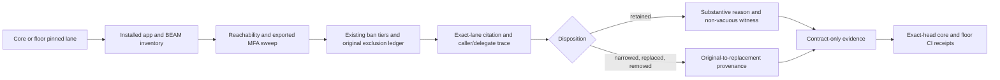

<user_constraints>
## User Constraints (from CONTEXT.md)

### Locked Decisions
### Delivery structure and identity
- **D-01:** The user chose same-level deliveries at the `.4` phase-size gate. This phase owns only CN-001, CN-002, CN-003, CN-004, CN-006, and CN-LANE-001 as listed in the roadmap; sampled CN-005 and the Logger/ExUnit dispositions remain with Phase 01.1.1.5. Do not renumber, merge, or replace original identities.
- **D-02:** Recompute each selected row's complete current exported-MFA match set independently on the exact core and floor lanes. Historical calibration bundles are locators only; they are not current acceptance totals. Never cap matches or infer live equality from old bundle membership.
- **D-03:** Establish one complete selected row as the production-quality tracer before expanding the slice: preserve original identity and provenance, complete current matches, exact-source citations, caller-input/delegate traces, semantic disposition, mirrored enforcement where applicable, compile-only evidence, and a non-vacuous removal witness where applicable. Resolve and deduplicate exact-lane sources before estimating the remaining work.

### Safety and evidence
- **D-04:** Do not invoke dangerous evaluator, parser, loader, or atom-creation APIs. Keep implementation changes contract-test-only; do not change `lib/` behavior, Credo guard logic, or add an allowlist, dependency, audit platform, or substitute exclusion.
- **D-05:** If a newly judged front is already called from `lib/`, stop the affected work and record its exact MFA, call site, caller-input trace, and triggering guard for the existing owner decision. Independent rows may continue only when they do not depend on the unresolved front; do not claim phase closure.
- **D-06:** Keep core and floor evidence separate and require the existing exact-head scoped green merge/CI receipts. A lane absence needs that lane's inventory/export evidence. No runtime atom-count, never-eval, or SEC-01 completion claim belongs here.
- **D-07:** The reserved Macro caller-AST judgment and final evidence-linked Credo wording review remain in Phase 01.1.1.4 after the relevant guards are verified. Do not make either decision in this slice.

### Planning and execution bounds
- **D-08:** Keep each delivery within five executable plans and support its scope with measured source ranges and active review intervals. If the complete selected rows do not fit, transfer whole original rows explicitly before execution; never split a row by dropping matches. Historical byte/token proxies are not actual token usage or hard caps.
- **D-09:** Carry forward the approved sequential execution policy from the ban-list work: execute one plan at a time without delegated execution agents, refresh the low-confidence remaining-work estimate at plan boundaries, and do not claim unavailable cumulative token use. Auto-advance stays disabled and work stops at this phase boundary.
- **D-10:** Phase 01.1.1.12 is a same-level, guard-only prerequisite for the confirmed CN-001 core and CN-003 both-lane public fronts. It owns no original row, semantic disposition, or ledger closure. This phase remains contract-test-only and begins executable planning only after `.12` is delivered green.

### the agent's Discretion
- Research and planning may select the smallest useful audit-record/helper shape and organize the selected rows by exact-source range, provided the original identity ledger remains authoritative, evidence is omission-sensitive and non-vacuous, and no new dependency or parallel audit authority is introduced.

### Deferred Ideas (OUT OF SCOPE)
None — discussion stayed within the approved phase split.
</user_constraints>

# Phase 01.1.1.6: Audit remaining ban-list call-name exclusions — Research

**Researched:** 2026-11-03
**Domain:** Elixir/OTP exact-lane security contract audit
**Confidence:** HIGH for scope, source authority and test architecture; MEDIUM for semantic audit work because no live exact-lane sweep or API execution was permitted.

## Summary

This is an omission-sensitive audit of five original call-name exclusion identities and one separate lane-metadata identity. Keep the preserved original ledger as the authority, then regenerate each selected row's complete current exported-MFA matches independently on core and floor. For every match, trace the caller-controlled arguments and delegates through exact-lane source, assign a source-backed disposition, and retain a substantive reason and non-vacuous lane witness when the row remains excluded. [VERIFIED: `.planning/phases/01.1.1.6-audit-remaining-ban-list-call-name-exclusions/01.1.1.6-CONTEXT.md:17-30`; `.planning/ROADMAP.md:277-285`]

The approved source resolver, lane inventory, tier sweep, and mirrored source/BEAM contract tests already provide the needed infrastructure. Reuse them. The earlier audit budget and calibration are historical locators, not current acceptance totals. One row must be completed end to end as the tracer before expanding the remaining rows. The only guard changes belong to prerequisite Phase 01.1.1.12; `.6` remains test-only and owns all semantic rows named here. [VERIFIED: `test/support/sweep_evidence.ex:14-24,45-67,99-118`; `test/contract/tier_sweep_test.exs:1464-1491,7897-7919`; `.planning/phases/01.1.1.12-add-mirrored-guard-coverage-for-confirmed-call-name-fronts/01.1.1.12-SCOPE-DECISION.md:3-24`]

**Planning gate (refreshed 2026-11-03):** The updated `.6` context records Phase 01.1.1.12 as delivered green and executable planning as unblocked. Live GitHub confirms three sequential merges with exact-head required-job receipts; D-10 is satisfied, so `.6` may proceed to executable planning. These receipts establish the prerequisite only, not any `.6` implementation, test, or semantic-row result. [VERIFIED: `.planning/phases/01.1.1.6-audit-remaining-ban-list-call-name-exclusions/01.1.1.6-CONTEXT.md:3-4`; [PR #42](https://github.com/szTheory/fablebook/pull/42) and [run 41678571723](https://github.com/szTheory/fablebook/actions/runs/41678571723); [PR #43](https://github.com/szTheory/fablebook/pull/43) and [run 41682609151](https://github.com/szTheory/fablebook/actions/runs/41682609151); [PR #44](https://github.com/szTheory/fablebook/pull/44) and [run 41687916873](https://github.com/szTheory/fablebook/actions/runs/41687916873)]

### Phase 01.1.1.12 Prerequisite Delivery Evidence

For each run, `core`, `floor`, `dialyzer`, `security`, and `ci-gate` completed successfully; `nightly` and `ci-health` were skipped under the existing allowance. The merged PRs are sequential deliveries. `origin/main` currently resolves to the #44 merge commit. These receipts satisfy the `.6` planning dependency only; local state and `.12` artifacts were not updated here. [VERIFIED: [run 41678571723](https://github.com/szTheory/fablebook/actions/runs/41678571723), [run 41682609151](https://github.com/szTheory/fablebook/actions/runs/41682609151), [run 41687916873](https://github.com/szTheory/fablebook/actions/runs/41687916873); [PR #42](https://github.com/szTheory/fablebook/pull/42), [PR #43](https://github.com/szTheory/fablebook/pull/43), [PR #44](https://github.com/szTheory/fablebook/pull/44); `git ls-remote origin refs/heads/main`]

| Delivery | Tested head | Required jobs | Run | Merge status |
|---|---|---|---|---|
| PR [#42](https://github.com/szTheory/fablebook/pull/42) | `c909307774b5dd2c7a35b8fb85fd807c9c962f29` | `core`, `floor`, `dialyzer`, `security`, `ci-gate`: success; `nightly`, `ci-health`: skipped | [41678571723](https://github.com/szTheory/fablebook/actions/runs/41678571723) | Merged green as `ff14a6ad787c5092ed8203e1dc2dae1cf2aaa50a` |
| PR [#43](https://github.com/szTheory/fablebook/pull/43) | `4ea370ab6b39a37613fea0483c1438f5dafc1dfe` | `core`, `floor`, `dialyzer`, `security`, `ci-gate`: success; `nightly`, `ci-health`: skipped | [41682609151](https://github.com/szTheory/fablebook/actions/runs/41682609151) | Merged green as `082a5c82dbd6e6a711a92791d8609e8040a5945c` |
| PR [#44](https://github.com/szTheory/fablebook/pull/44) | `fb69506c458324fbacd88a5ac0d90de5529bfacc` | `core`, `floor`, `dialyzer`, `security`, `ci-gate`: success; `nightly`, `ci-health`: skipped | [41687916873](https://github.com/szTheory/fablebook/actions/runs/41687916873) | Merged green as `716ef4613312badee0a0fff942eab218ebc1b88c`; equals current `origin/main` |

### Checkout and Runtime Caveats

At refresh time, live `origin/main` resolved to `716ef4613312badee0a0fff942eab218ebc1b88c`, while the local code snapshot was based on `6ac21f6d2e8903a5124aa6a7d4930969d6cd5205`; the live merge commit was not present in this checkout's object database. Therefore, this source snapshot may predate the merged `.12` guard code; do not treat local files as proof that the guard update is present. The local `.6` plan's first-task precondition requires an execution HEAD containing the `.12` merge before edits begin. [VERIFIED: `git ls-remote origin refs/heads/main` returned `716ef4613312badee0a0fff942eab218ebc1b88c`; `git rev-parse HEAD` returned `6ac21f6d2e8903a5124aa6a7d4930969d6cd5205`; `git cat-file -t 716ef4613312badee0a0fff942eab218ebc1b88c` reported the object unavailable locally; `.planning/phases/01.1.1.6-audit-remaining-ban-list-call-name-exclusions/01.1.1.6-01-PLAN.md:81-84`]

The local exact core and floor toolchain probes previously reported version mismatches; the configured versions are Elixir 1.20.4 / OTP 29.1.2 and Elixir 1.18.5 / OTP 27.3.4.9. Use the exact execution checkout and lane runtimes for local evidence, then require the `.6` delivery's own exact-head CI receipts. The `.12` receipts do not substitute for these future `.6` checks. [VERIFIED: `bin/lane core doctor`, `bin/lane floor doctor` outputs recorded during this research; `.tool-versions`; `.tool-versions.floor`; `.planning/phases/01.1.1.6-audit-remaining-ban-list-call-name-exclusions/01.1.1.6-VALIDATION.md`]

## Architectural Responsibility Map

| Capability | Primary Tier | Secondary Tier | Rationale |
|---|---|---|---|
| Enumerate reachable exported functions and compare them with ban tiers | Test / contract harness | — | The sweep builds lane-specific source/BEAM evidence and asserts dispositions; it does not change runtime application behavior. [VERIFIED: `test/contract/tier_sweep_test.exs:6918-6971,7897-7919`] |
| Bind citations to installed source and lane identity | Test support / evidence resolver | — | `SweepEvidence` validates lane pins, archive and source digests, installed-root containment, and cited line bounds. [VERIFIED: `test/support/sweep_evidence.ex:14-24,28-42,45-67,99-118,220-231`] |
| Detect banned source and compiled calls in `lib/` | Static source guard plus contract mirror | Compile-only fixture | Credo owns the source check; `BeamWalker` and `banned_calls_test.exs` verify compiled BEAMs. This phase does not edit the guard. [VERIFIED: `credo/checks/banned_calls.ex:18-24`; `test/support/beam_walker.ex:4-45`; `test/contract/banned_calls_test.exs:1-10`] |

## Standard Stack

### Core

| Component | Version | Purpose | Why Standard |
|---|---|---|---|
| Elixir / OTP core lane | Elixir 1.20.4 / OTP 29.1.2 | Full core installed-source and BEAM inventory | Project's pinned core lane. The resolver requires exact lane identity. [VERIFIED: `test/support/sweep_evidence.ex:16-24`; quote: `"core" => %{ "otp" => ["29.1.2", ...], "elixir" => ["1.20.4", ...] }`] |
| Elixir / OTP floor lane | Elixir 1.18.5 / OTP 27.3.4.9 | Compatibility floor inventory | Project's separately pinned floor lane. Keep its match set, source, and absence evidence independent. [VERIFIED: `test/support/sweep_evidence.ex:16-24`; quote: `"floor" => %{ "otp" => ["27.3.4.9", ...], "elixir" => ["1.18.5", ...] }`] |
| ExUnit, Credo, Xref, `BeamWalker`, `SweepEvidence` | Existing repository versions | Sweep and contract-test evidence | Reuse established test and source-evidence seams; no package is needed for this phase. [VERIFIED: `test/contract/tier_sweep_test.exs:60-72`; `test/support/beam_walker.ex:1-45`; `test/support/sweep_evidence.ex:1-24`; `docs/adr/0018-dependency-budget.md`] |

### Supporting

No external package installation is in scope. `bin/lane` selects `.tool-versions` or `.tool-versions.floor` and the corresponding lockfile, and runs tests only after verifying the exact asdf runtime. [VERIFIED: `bin/lane:43-77,106-127,186-198`; quote: `versions_file='.tool-versions'`, `versions_file='.tool-versions.floor'`, `lockfile='mix.lock'`, `lockfile='mix.floor.lock'`]

### Package Legitimacy Audit

Not applicable: this phase adds no external packages. [VERIFIED: `.planning/phases/01.1.1.6-audit-remaining-ban-list-call-name-exclusions/01.1.1.6-CONTEXT.md:22`]

### Alternatives Considered

| Instead of | Could Use | Tradeoff |
|---|---|---|
| Existing identity ledger, exact source resolver, and lane sweep | New audit authority or generic taint-analysis framework | Rejected by locked scope; another authority could drift from original identity or lane evidence. [VERIFIED: `.planning/phases/01.1.1.6-audit-remaining-ban-list-call-name-exclusions/01.1.1.6-CONTEXT.md:17-24,32-33`] |

## Architecture Patterns

### System Architecture Diagram



The diagram follows the existing lane-specific sweep and evidence flow. A lane absence must be supported by that lane's inventory/export evidence; lack of a source citation alone is not proof of absence. [VERIFIED: `test/contract/tier_sweep_test.exs:6918-6928,7897-7919`; `.planning/phases/01.1.1.6-audit-remaining-ban-list-call-name-exclusions/01.1.1.6-CONTEXT.md:18-24`]

### Recommended Project Structure

Keep implementation in the existing contract surfaces: `test/contract/tier_sweep_test.exs`, `test/contract/banned_calls_test.exs`, existing support helpers, and phase-local evidence. Do not change `lib/`, `credo/checks/banned_calls.ex`, or source authority. [VERIFIED: `.planning/phases/01.1.1.6-audit-remaining-ban-list-call-name-exclusions/01.1.1.6-CONTEXT.md:22-24,67-92`; `docs/adr/0014-testing-strategy.md`; `docs/adr/0021-delivery-rules.md`]

### Pattern 1: Tracer-first row audit

**What:** Carry one complete original row through identity/provenance, live matches, source citations, caller/delegate trace, substantive disposition, mirrored enforcement when applicable, compile-only evidence, and its removal witness before using that workflow on the rest.
**When to use:** At the start of `.6`, as required by D-03.
**Why:** It reveals source deduplication and evidence-shape costs before the row set expands; do not treat old bundles as current match totals. [VERIFIED: `.planning/phases/01.1.1.6-audit-remaining-ban-list-call-name-exclusions/01.1.1.6-CONTEXT.md:18-19,28`; `.planning/phases/01.1.1.4-complete-the-remaining-ban-list-semantic-audit-and-closure/01.1.1.4-PLANNING-OUTCOME.md`]

### Pattern 2: Lane-bound source evidence

`SweepEvidence` first pins lane identity and archive/lock digests, then resolves a citation against that lane's installed tree or approved archive, checks containment and content digest, and rejects a missing lane record. Preserve that chain and record core/floor separately. [VERIFIED: `test/support/sweep_evidence.ex:14-24,28-42,45-67,99-118,220-231`]

### Pattern 3: Independent source and BEAM guard mirrors

Use existing source and compiled-BEAM guard contracts with dangerous calls held in uncalled fixture bodies. Static detection demonstrates the guard sees a call shape; it does not demonstrate runtime atom-count or never-eval behavior. [VERIFIED: `test/contract/banned_calls_test.exs:1-10`; `test/support/beam_walker.ex:4-45`; `docs/adr/0014-testing-strategy.md`; `.planning/phases/01.1.1.6-audit-remaining-ban-list-call-name-exclusions/01.1.1.6-CONTEXT.md:22-25`]

**Example — current call-name matcher semantics:**

```elixir
defp call_name_exclusion_match?({module, functions}, {module, function, _arity})
     when is_list(functions),
     do: function in functions

defp call_name_exclusion_match?(_matcher, _mfa), do: false
```

This is the existing matcher verbatim; it matches the named module/function pair without arity filtering. [VERIFIED: `test/contract/tier_sweep_test.exs:8999-9003`; quote: `when is_list(functions)`, `do: function in functions`, `defp call_name_exclusion_match?(_matcher, _mfa), do: false`]

### Anti-Patterns to Avoid

- **Treating an old budget as live equality:** old data is useful to locate rows; the live full-export set must be recomputed per lane. [VERIFIED: `.planning/phases/01.1.1.6-audit-remaining-ban-list-call-name-exclusions/01.1.1.6-CONTEXT.md:18`; `.planning/phases/01.1.1.5-complete-atom-creator-fronts-and-audit-calibration/01.1.1.5-CALIBRATION.md:29-33`]
- **Judging by a function name or reason label:** follow arguments and delegates into behavior; a label such as `not_compile_module` is not a disposition by itself. [VERIFIED: `.planning/phases/01.1.1.1-finish-the-ban-list-atom-creators-every-installed-otp-app-an/01.1.1.1-CONTEXT.md:22-24,31-34`; `test/contract/tier_sweep_test.exs:81-120`]
- **Treating no source row as a lane absence:** require exact-lane inventory/export proof. [VERIFIED: `test/support/sweep_evidence.ex:220-231`; `.planning/phases/01.1.1.6-audit-remaining-ban-list-call-name-exclusions/01.1.1.6-CONTEXT.md:24`]
- **Invoking an audited evaluator, parser, loader, or atom creator to prove semantics:** keep dangerous operations uncalled; use source tracing and compile-only fixtures. [VERIFIED: `docs/adr/0004-no-eval-no-new-atoms.md`; `.planning/phases/01.1.1.6-audit-remaining-ban-list-call-name-exclusions/01.1.1.6-CONTEXT.md:22`]
- **Continuing after a `lib/` collision:** stop the affected row and record exact MFA, call site, caller-input trace, and triggering guard for its owner decision. [VERIFIED: `.planning/phases/01.1.1.6-audit-remaining-ban-list-call-name-exclusions/01.1.1.6-CONTEXT.md:23`]

## Don't Hand-Roll

| Problem | Don't Build | Use Instead | Why |
|---|---|---|---|
| Installed source identity and citation validation | A second resolver or hand-maintained source manifest | `SweepEvidence` and its approved archive | It already binds lane, locks, manifest, digest, containment, and citation bounds. [VERIFIED: `test/support/sweep_evidence.ex:14-24,45-67,99-118,220-231`] |
| Original exclusion IDs and row ownership | A replacement ledger or re-numbered rows | Existing original identity source and ledger in the tier sweep | Stable original provenance is part of acceptance. [VERIFIED: `test/contract/tier_sweep_test.exs:1464-1493,9473-9575`; `.planning/phases/01.1.1.6-audit-remaining-ban-list-call-name-exclusions/01.1.1.6-CONTEXT.md:17`] |
| Security proof for input-driven evaluation/atom behavior | Calls to dangerous APIs or broad runtime claims from static checks | Existing static guard contracts and Phase 5 runtime proofs | Compile-only evidence has a narrower claim boundary. [VERIFIED: `docs/adr/0004-no-eval-no-new-atoms.md`; `docs/adr/0014-testing-strategy.md`; `.planning/REQUIREMENTS.md:159-165,365-369`] |

**Key insight:** The existing contract harness already distinguishes full reachable exports, guard coverage, exclusions, lane source evidence, and original row identity. The implementation work is semantic classification and complete evidence, not building another scan or authority. [VERIFIED: `test/contract/tier_sweep_test.exs:6918-6971,7897-7919,9473-9620`]

## Common Pitfalls

### Pitfall 1: Stale match sets

**What goes wrong:** A row's current core/floor matches are inferred from the historical audit budget or calibration membership.
**Why it happens:** Those artifacts are detailed and tempting to treat as acceptance totals.
**How to avoid:** Recompute from each current full exported-MFA set in both exact lanes, compare to the preserved row, and never cap it.
**Warning signs:** No lane-specific live equality assertion or a missing floor absence record. [VERIFIED: `.planning/phases/01.1.1.6-audit-remaining-ban-list-call-name-exclusions/01.1.1.6-CONTEXT.md:18,24`; `test/contract/tier_sweep_test.exs:10171-10201`]

### Pitfall 2: Vacuous removal witnesses

**What goes wrong:** A removed or narrowed entry appears safe because its test has no matching probe.
**How to avoid:** Assert the original front is detected and removing/narrowing only that front makes the intended finding disappear while adjacent guard behavior remains. Keep witnesses lane-specific. [VERIFIED: `.planning/phases/01.1.1.6-audit-remaining-ban-list-call-name-exclusions/01.1.1.6-CONTEXT.md:19,24`; `test/contract/banned_calls_test.exs:1310-1365,1490-1530`]

### Pitfall 3: Missing caller control-flow

**What goes wrong:** A function is retained or removed based only on its name or immediate body, missing caller-chosen text/path/module inputs or a delegate.
**How to avoid:** Trace public callers, arguments, and delegates in each lane. For example, the currently checked-out `Plug.Builder.compile/3` source converts `Module.split(plug)` pieces with `String.to_atom/1`; the original row's `not_compile_module` label does not settle the caller-input analysis. This observation is a trace target, not a final disposition. [VERIFIED: `deps/plug/lib/plug/builder.ex:322-324,379-386`; `test/contract/tier_sweep_test.ex:1474-1479`]

### Pitfall 4: Guard prerequisite confused with row closure

**What goes wrong:** The `.12` addition is treated as semantic disposition or completion of CN-001/CN-003.
**How to avoid:** `.12` adds only the confirmed static guard fronts; `.6` still owns all matches, citations, input traces, dispositions, witnesses, and row provenance. [VERIFIED: `.planning/phases/01.1.1.12-add-mirrored-guard-coverage-for-confirmed-call-name-fronts/01.1.1.12-SCOPE-DECISION.md:3-24,26-28`]

## Code Examples

The current call-name exclusion definitions are the source-of-truth matcher/citation inputs. The selected entries are preserved verbatim here as identity anchors:

```elixir
{{Mix.Compilers.Protocol, [:compile]}, :not_compile_module,
 ["mix/lib/mix/compilers/protocol.ex:107", "mix/lib/mix/compilers/protocol.ex:162"]}
{{Phoenix.Digester, [:compile]}, :not_compile_module,
 ["phoenix/lib/phoenix/digester.ex:20", "phoenix/lib/phoenix/digester.ex:93"]}
{{Phoenix.LiveView.ColocatedAssets, [:compile]}, :not_compile_module,
 ["phoenix_live_view/lib/phoenix_live_view/colocated_assets.ex:48",
  "phoenix_live_view/lib/phoenix_live_view/colocated_assets.ex:93"]}
{{Plug.Builder, [:compile]}, :not_compile_module,
 ["plug/lib/plug/builder.ex:324", "plug/lib/plug/builder.ex:358",
  "plug/lib/plug/builder.ex:382"]}
{{:re, [:compile]}, :not_compile_module,
 ["stdlib/src/re.erl:128", "stdlib/src/re.erl:288", "stdlib/src/re.erl:86", "stdlib/src/re.erl:236"]}
{{Mix.Compilers.Protocol, [:compile]}, :latest}
```

These rows are quoted from the active declarations, where the first five selected identities occupy CN-001, CN-002, CN-003, CN-004, and CN-006; the last is separate CN-LANE-001 metadata. Keep `CN-005` owned by `.5`. [VERIFIED: `test/contract/tier_sweep_test.exs:1464-1491`; original snapshot: `.planning/phases/01.1.1.5-complete-atom-creator-fronts-and-audit-calibration/01.1.1.5-ORIGINAL-IDENTITY-SOURCE.txt:14-41`]

The selected citations must be resolved against the exact installed lane or approved archive, not copied forward as accepted source evidence. `CN-001` has a core `Mix.Compilers.Protocol.compile/4` trace to `Code.prepend_path/1`; the approved floor inventory lacks that target export. `CN-003` has both-lane provenance through `Module.concat/1` before `Code.ensure_loaded?/1`. These are confirmed guard fronts, while semantic dispositions remain `.6` work. [VERIFIED: `.planning/phases/01.1.1.12-add-mirrored-guard-coverage-for-confirmed-call-name-fronts/01.1.1.12-SCOPE-DECISION.md:7-19`]

## State of the Art

| Old Approach | Current Approach | When Changed | Impact |
|---|---|---|---|
| Use historical budget/citation membership as row acceptance | Compare each preserved row to live full-export matches and exact-lane source evidence | Set by `.6` D-02 | Old records remain locators only. [VERIFIED: `.planning/phases/01.1.1.6-audit-remaining-ban-list-call-name-exclusions/01.1.1.6-CONTEXT.md:18`] |
| Combine guard and semantic-row ownership | `.12` owns the guard-only update; `.6` owns original row semantics | `.12` scope decision, 2026-11-03 | Keep the guard PR independent from contract tests and row disposition. [VERIFIED: `.planning/phases/01.1.1.12-add-mirrored-guard-coverage-for-confirmed-call-name-fronts/01.1.1.12-SCOPE-DECISION.md:3,14-28`] |

**Deprecated/outdated:** Historical calibration match sets are not current acceptance totals. The previous sample demonstrates the audit method only. [VERIFIED: `.planning/phases/01.1.1.5-complete-atom-creator-fronts-and-audit-calibration/01.1.1.5-CALIBRATION.md:29-33`]

## Assumptions Log

| # | Claim | Section | Risk if Wrong |
|---|---|---|---|

No assumed technical or policy claims are used. Current live selected-row core/floor equality remains an execution evidence requirement and has not been recomputed in this research pass because project tests were explicitly out of scope.

## Open Questions

1. **What are the complete current selected-row match sets on each exact lane?**
   - **Disposition: RESOLVED FOR PLANNING.** Plans 01–05 assign live, full-export core and floor recomputation and lane comparison as acceptance for each row. Historical budget/calibration sets and static planning-scope match locators are discovery aids only; they are not accepted totals. [VERIFIED: `.planning/phases/01.1.1.6-audit-remaining-ban-list-call-name-exclusions/01.1.1.6-COVERAGE-AUDIT.md:17,24`; `.planning/phases/01.1.1.6-audit-remaining-ban-list-call-name-exclusions/01.1.1.6-01-PLAN.md:87-97`; `.planning/phases/01.1.1.6-audit-remaining-ban-list-call-name-exclusions/01.1.1.6-02-PLAN.md:87-97`; `.planning/phases/01.1.1.6-audit-remaining-ban-list-call-name-exclusions/01.1.1.6-03-PLAN.md:84-94`; `.planning/phases/01.1.1.6-audit-remaining-ban-list-call-name-exclusions/01.1.1.6-04-PLAN.md:86-96`; `.planning/phases/01.1.1.6-audit-remaining-ban-list-call-name-exclusions/01.1.1.6-05-PLAN.md:98-121`]
   - **Execution acceptance remains pending:** The full current sets have not been recomputed in this research pass. Each plan must capture the complete current lane results, including explicit absences, before disposition; prior totals cannot substitute.

2. **Which selected front has a `lib/` caller after the new `.12` tiers land?**
   - **Disposition: RESOLVED FOR PLANNING.** The plans require exact-source/static review plus compiled-BEAM collision checks and preserve D-05 fail-closed behavior. Any newly judged front called from `lib/` stops that affected row; report its exact MFA, call site, caller-controlled input trace, and triggering guard. [VERIFIED: `.planning/phases/01.1.1.6-audit-remaining-ban-list-call-name-exclusions/01.1.1.6-COVERAGE-AUDIT.md:20-22,27`; `.planning/phases/01.1.1.6-audit-remaining-ban-list-call-name-exclusions/01.1.1.6-CONTEXT.md:23`; `.planning/phases/01.1.1.6-audit-remaining-ban-list-call-name-exclusions/01.1.1.6-03-PLAN.md:84-106`; `.planning/phases/01.1.1.6-audit-remaining-ban-list-call-name-exclusions/01.1.1.6-04-PLAN.md:86-108`; `.planning/phases/01.1.1.6-audit-remaining-ban-list-call-name-exclusions/01.1.1.6-05-PLAN.md:116-121`]
   - **Execution acceptance remains pending:** No post-`.12` source/BEAM collision proof is claimed here. Do not report no collision unless the required scan establishes it; a collision withholds that row's disposition and phase closure.

3. **Can all selected rows fit within the approved five-plan ceiling?**
   - **Disposition: RESOLVED FOR PLANNING.** The reviewed decomposition assigns all complete original rows into exactly five sequential plans: Plan 01 CN-002; Plan 02 CN-001 plus the separate CN-LANE-001 metadata identity; Plan 03 CN-003; Plan 04 CN-004; Plan 05 CN-006. The coverage audit explicitly records planned coverage, not implementation or test evidence. [VERIFIED: `.planning/phases/01.1.1.6-audit-remaining-ban-list-call-name-exclusions/01.1.1.6-COVERAGE-AUDIT.md:3,9-14,30`; `.planning/phases/01.1.1.6-audit-remaining-ban-list-call-name-exclusions/01.1.1.6-CONTEXT.md:28`]
   - **Execution acceptance remains pending:** Refresh source expansion and effort at each plan boundary. If actual scope does not fit, transfer a whole original row before its execution; do not split away or truncate any row's complete match set. This resolves plan structure, not actual implementation effort or completed work.

## Environment Availability

| Dependency | Required By | Available | Version | Fallback |
|---|---|---|---|---|
| Exact core Elixir/OTP | Core sweep and contract checks | No, local runtime mismatch | Required pins: Elixir 1.20.4 / OTP 29.1.2 | Exact-head core CI after a valid runtime is selected |
| Exact floor Elixir/OTP | Floor sweep and contract checks | No, local runtime mismatch | Required pins: Elixir 1.18.5 / OTP 27.3.4.9 | Exact-head floor CI after a valid runtime is selected |
| asdf | `bin/lane` toolchain selection | Yes | Present; pinned runtime versions missing/incomplete | Install pins via project setup outside this research step, or rely on exact-head CI |

The read-only `bin/lane core doctor` and `bin/lane floor doctor` checks report both lane runtimes as mismatched; lane build/dependency directories exist. The project script verifies exact runtime and lockfile before test execution. [VERIFIED: command output from `bin/lane core doctor` and `bin/lane floor doctor`; script: `bin/lane:43-77,106-145`]

**Missing dependencies with no fallback:** None if exact-head core/floor CI is available.
**Missing dependencies with fallback:** Both exact local runtimes; the project requires separate exact-head core/floor receipts for delivery.

## Validation Architecture

### Test Framework

| Property | Value |
|---|---|
| Framework | Existing ExUnit contract suite; Credo custom check and compiled-BEAM mirror |
| Config file | Existing Mix project and `bin/lane`; no new framework config |
| Quick run command | After the prerequisite and with exact runtime installed: `bin/lane core test test/contract/tier_sweep_test.exs test/contract/banned_calls_test.exs` |
| Full suite command | `bin/lane core mix ci` plus `bin/lane floor mix ci`; separate exact-head CI receipts remain required |

Commands are planning guidance only; none was run during this research. Existing tests cover full sweep, banned-module call-name exclusions, source checks, compiled BEAM checks, exact identity ledger, and sample witnesses. [VERIFIED: `test/contract/tier_sweep_test.exs:6918-6971,9473-9620`; `test/contract/banned_calls_test.exs:1-10`; `bin/lane:186-201`; `docs/adr/0017-ci-cd-layout.md`]

### Phase Requirements → Test Map

The roadmap declares `Requirements: None` for `.6`; no requirement ID is advanced by this phase. Acceptance is mapped to its roadmap criteria instead. [VERIFIED: `.planning/ROADMAP.md:277-285`]

| Roadmap behavior | Test Type | Automated Evidence | Existing? |
|---|---|---|---|
| Preserve each selected original identity and replacement provenance | Contract | Ledger tests derive original entries and reject missing/duplicate/substituted identities | Yes; extend only in existing contract surfaces |
| Recompute full current match sets per lane | Contract | Full exported-MFA comparison per exact lane; no cap and explicit absence evidence | Existing sweep foundations; selected-row audit still needed |
| Prove source-backed caller traces and substantive dispositions | Contract plus review evidence | Resolver citations plus omission-sensitive per-row audit records | Resolver exists; selected dispositions not yet implemented |
| Retained rows have non-vacuous lane witnesses | Contract | Positive probe plus focused tier-removal consequence per applicable lane | Pattern exists for prior sample; selected rows need evidence |
| Avoid dangerous execution; stop on `lib/` collision | Contract/static | Uncalled compile-only fixtures and collision contract | Existing guard mirror; post-`.12` check needed |
| Deliver scoped green changes | CI | Exact-head core and floor green receipts | Required after implementation; not research evidence |

### Sampling Rate

- **Per plan:** Run the narrow relevant contract slice through the exact matching lane after the `.12` gate and runtime setup.
- **Per delivery:** Run full `bin/lane core mix ci` and `bin/lane floor mix ci`; merge only with scoped exact-head green receipts.
- **Phase gate:** Confirm all roadmap criteria and unchanged out-of-scope claims before marking `.6` delivered.

### Wave 0 Gaps

- No test framework install or configuration gap was found. Reuse the current contract harness. The exact core/floor runtime pins are missing locally; establish an exact environment or run the exact-head CI lanes before execution. [VERIFIED: `bin/lane:106-145`; `test/contract/tier_sweep_test.exs:60-72`]

## Security Domain

Security enforcement is enabled at ASVS Level 1 in project configuration. [VERIFIED: `.planning/config.json:49-51`; quote: `"security_enforcement": true`, `"security_asvs_level": 1`, `"security_block_on": "high"`]

### Applicable ASVS Categories

ASVS 5.0.0 is the current stable OWASP ASVS release. Its V2 is “Validation and Business Logic”; V5 is “File Handling”; V6 is “Authentication”; V7 is “Session Management”; and V8 is “Authorization.” [CITED: [OWASP ASVS 5.0.0](https://asvs.owasp.org/); [V2](https://github.com/OWASP/ASVS/blob/master/5.0/en/0x11-V2-Validation-and-Business-Logic.md); [V5](https://github.com/OWASP/ASVS/blob/master/5.0/en/0x14-V5-File-Handling.md); [official ASVS 5.0.0 source](https://github.com/OWASP/ASVS/blob/master/5.0/docs_en/OWASP_Application_Security_Verification_Standard_5.0.0_en.xml)]

| ASVS Category | Applies | Phase control |
|---|---|---|
| V2 Validation and Business Logic | Yes | Trace caller-controlled inputs and delegates; classify actual behavior instead of trusting names/reason labels. [CITED: ASVS V2; VERIFIED: `.planning/phases/01.1.1.1-finish-the-ban-list-atom-creators-every-installed-otp-app-an/01.1.1.1-CONTEXT.md:22-24`] |
| V5 File Handling | Yes, where a front consumes paths/files | Follow path and file arguments to effects; source citation absence must be distinguished from lane export absence. [CITED: ASVS V5; VERIFIED: `test/support/sweep_evidence.ex:99-118,220-231`] |
| V6 Authentication | No | This phase adds no identity or authentication path. |
| V7 Session Management | No | This phase adds no session behavior. |
| V8 Authorization | No | This phase adds no authorization behavior. |
| Cryptographic controls | No | No cryptographic implementation is added. |

### Known Threat Patterns for Elixir/OTP audit contracts

| Pattern | STRIDE | Standard Mitigation |
|---|---|---|
| Caller-chosen string/path/module reaches atom creation, evaluation, compilation, or loading | Tampering / Elevation of Privilege | Trace the input to sink through exact source; do not invoke the sink; preserve existing static bans and add compile-only evidence only within authorized scope. [VERIFIED: `docs/adr/0004-no-eval-no-new-atoms.md`; `.planning/phases/01.1.1.6-audit-remaining-ban-list-call-name-exclusions/01.1.1.6-CONTEXT.md:22-24`] |
| Source citation comes from a wrong lane, stale artifact, or unverified path | Tampering | Bind evidence to pinned lane, source manifest, digest, root containment, and line bounds. [VERIFIED: `test/support/sweep_evidence.ex:28-42,99-118,220-231`] |
| Empty witness or omitted match yields false green | Tampering | Use complete-set equality and positive/non-vacuous witnesses. [VERIFIED: `test/contract/tier_sweep_test.exs:10171-10201`; `.planning/phases/01.1.1.6-audit-remaining-ban-list-call-name-exclusions/01.1.1.6-CONTEXT.md:18-19`] |

## Project Constraints (from AGENTS.md)

No repository-root `AGENTS.md` file is present. The injected project instructions and `CLAUDE.md` require: preserve intent/ADR precedence; never weaken quality gates; no runtime eval or atoms from input; no new dependency without ADR; keep guard tests separate from guarded implementation; keep exact-head core/floor green evidence; and stop this phase at its boundary. These match `.6` locked decisions and are not permission to plan execution before `.12` is green. [VERIFIED: `CLAUDE.md:7-32`; `.planning/phases/01.1.1.6-audit-remaining-ban-list-call-name-exclusions/01.1.1.6-CONTEXT.md:22-30`]

## Sources

### Primary (HIGH confidence)

- Current original row definitions and full-sweep contracts: `test/contract/tier_sweep_test.exs`.
- Exact-lane source authority: `test/support/sweep_evidence.ex` and approved `test/fixtures/guards/exact_sources.tar.gz` binding.
- Mirrored guard contract: `test/contract/banned_calls_test.exs`, `test/support/beam_walker.ex`, `credo/checks/banned_calls.ex`.
- Locked current slice and gate: `.planning/phases/01.1.1.6-audit-remaining-ban-list-call-name-exclusions/01.1.1.6-CONTEXT.md`, `.planning/ROADMAP.md`, `.planning/STATE.md`.
- `.12` guard boundary: `.planning/phases/01.1.1.12-add-mirrored-guard-coverage-for-confirmed-call-name-fronts/01.1.1.12-SCOPE-DECISION.md`.
- Live `.12` prerequisite deliveries: [PR #42](https://github.com/szTheory/fablebook/pull/42) / [run 41678571723](https://github.com/szTheory/fablebook/actions/runs/41678571723), [PR #43](https://github.com/szTheory/fablebook/pull/43) / [run 41682609151](https://github.com/szTheory/fablebook/actions/runs/41682609151), and [PR #44](https://github.com/szTheory/fablebook/pull/44) / [run 41687916873). The live `origin/main` ref resolves to merge `716ef4613312badee0a0fff942eab218ebc1b88c`.
- Security and delivery: ADRs 0004, 0014, 0017, 0018, 0021; `.planning/REQUIREMENTS.md` §SEC; `.planning/VERIFICATION.md`.

### Secondary (MEDIUM confidence)

- Phase `.5` calibration and delivered scope, used only as a method/sample reference: `01.1.1.5-CALIBRATION.md`, `01.1.1.5-DELIVERY.json`, and `01.1.1.5-ORIGINAL-IDENTITY-SOURCE.txt`.
- Phase `.4` historical sizing and split rationale: `01.1.1.4-PLANNING-OUTCOME.md`, `01.1.1.4-PLANNING-SCOPE.json`.

### Official security reference

- OWASP ASVS overview and release: https://asvs.owasp.org/ (stable 5.0.0).
- OWASP ASVS V2 Validation and Business Logic: https://github.com/OWASP/ASVS/blob/master/5.0/en/0x11-V2-Validation-and-Business-Logic.md.
- OWASP ASVS V5 File Handling: https://github.com/OWASP/ASVS/blob/master/5.0/en/0x14-V5-File-Handling.md.
- OWASP ASVS 5.0.0 official source: https://github.com/OWASP/ASVS/blob/master/5.0/docs_en/OWASP_Application_Security_Verification_Standard_5.0.0_en.xml.

## Metadata

**Confidence breakdown:**
- Standard stack: HIGH — versions and lane selection are pinned in the source resolver and project toolchain files.
- Architecture: HIGH — based on currently opened implementation and contract source.
- Semantic dispositions: MEDIUM — current selected-row exact-lane sets and caller traces remain execution evidence; none was run here.
- Environment availability: HIGH — both `bin/lane ... doctor` probes report exact runtime mismatch.

**Research date:** 2026-11-03
**Valid until:** 2026-12-03 for codebase architecture; refresh runtime availability and current exported sets immediately before execution.
