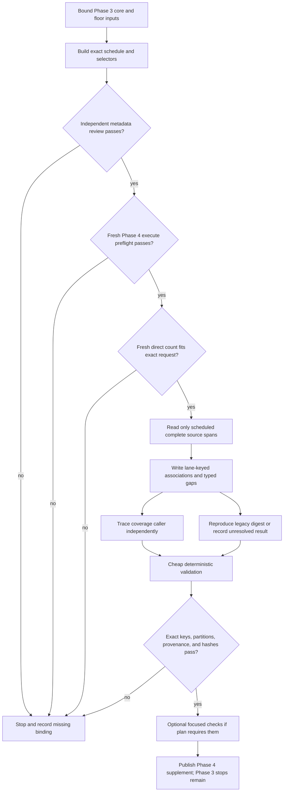

<user_constraints>
## User Constraints

> **Budget history:** The 100,000-token ceiling below is the original Phase 4 decision as researched on 2026-11-16. INT-20261117-01 later supersedes that ceiling only for the remaining Phase 4/Phase 3 recovery, using a 150,000 incremental generated-output-token envelope and the same protected 31,000 reserve. The source scope and every source-read gate remain unchanged; see `04-CONTEXT.md` and `../../forensics/phase4-budget-reset-20261117.md`.

### Locked Decisions

#### Evidence coverage and provenance
- **D-01:** Cover the complete 226-ID set independently for core and floor. Aggregate counts and representative examples are not sufficient. Every source association or gap must remain keyed to its identity and lane.
- **D-02:** Keep callback/delegate and graph limitations visible as keyed gaps with exact reason and remedy. Never invoke audited functions or infer safety from missing or unrun observations.
- **D-03:** Trace the caller that computes source coverage and establish the stored nested SIZING digest recipe against the complete records.

### Limits and bounded outcome
- **D-04:** Use the standard 100,000-token ceiling with the fixed 31,000-token reserve. Do not increase the budget. Retain the 34,000-token compact-context ceiling, the five-exact-source-file cap per task, and the no-truncation rule. Allocate source tokens only after exact spans, independent metadata review, execute preflight, and fresh direct count are bound.
- **D-05:** Run cheap consistency checks before long tests or suites. If the selected evidence does not fit or required provenance is unavailable, record the exact gap and stop; do not fabricate rows, select a candidate, or request automatic budget expansion.
- **D-06:** Preserve Phase 3's stop and all safety gates. Phase 4 evidence does not automatically resume or complete Phase 3 and does not authorize implementation or another follow-on.

### the agent's Discretion
- Select the smallest auditable supplemental record format and deterministic digest procedure that the evidence supports.
- Use the existing lane-specific inventory, source-resolution, archive-lock, and test-support patterns. Prefer a separate Phase 4 supplement so earlier Phase 3 records and receipts remain unchanged.
- Decide whether any focused test is necessary after the evidence package passes cheap consistency checks; do not run long lane suites unless the plan establishes that they are required.

### Deferred Ideas (OUT OF SCOPE)

Guard implementation, callback execution, dynamic-caller or native-runtime claims, candidate promotion, aggregate closure, Walking Skeleton, SEC-01, and any automatic follow-on remain outside this phase.
</user_constraints>

<phase_requirements>
## Phase Requirements

| ID | Description | Research Support |
|----|-------------|------------------|
| GSR-03 | For surviving scope on both lanes, the evidence links each row's matched targets to exact source identities and relevant caller/delegate paths. Missing source, caller, or provenance evidence is reported as an open gap and prevents candidate selection. | Produce an exhaustive keyed association-or-gap partition per lane; keep source resolution and caller closure as separate findings. |
| GSR-05 | The rejoin produces current source-file, context-token, and effort sizing for a candidate bounded increment. Any proposal fits the 100,000-token planning limit, at most five exact-source files per task, 2–3 tasks per plan, at most five plans per phase, and roughly three working days per plan; otherwise it reports the concrete gap without truncation or substitution. | Bind every source request to an exact reviewed schedule and fresh direct count, preserve the fixed 31,000-token reserve and 34,000-token compact-context cap, and stop on missing evidence or fit. |
</phase_requirements>

# Phase 4: Evidence-only source and gap provenance closure - Research

**Researched:** 2026-11-17  
**Domain:** Lane-pinned source provenance, typed gaps, caller coverage tracing, and deterministic evidence digests  
**Confidence:** MEDIUM — requirements, resource bounds, prior metadata, and output contract are explicit; source/caller resolution and the legacy digest recipe intentionally remain unobserved until the execution gates pass.

## Summary

Plan Phase 4 as a separate evidence supplement that preserves all earlier Phase 3 lane records and immutable receipts. The contract requires all 226 original identities independently on core and floor, with every known identity/MFA represented exactly once by a lane-specific source association or typed gap. An identity whose target set is not known must remain an explicit identity-level unknown; it must not be converted into an empty set or an absence claim. The prior trace receipt confirms the current lane records each have 226 identities but do not contain keyed target-source associations or typed source gaps, and the SIZING coverage flag conflicts with nonzero aggregate gap counts. Those facts require keyed reconciliation, not a count-only conclusion. `[VERIFIED: .planning/phases/04-evidence-only-source-and-gap-provenance-closure/04-CONTEXT.md:8-12,19-21; .planning/phases/03-guard-aggregate-scope-rejoin-and-candidate-sizing/03-04-BOUNDED-TRACE-STOP.md:21-28]`

Use the six stable consumer artifacts from Phase 3's final plan. Make cheap artifact checks the first execution layer. A pass for record completeness only establishes that the supplement is structurally complete and internally consistent. It does not establish that the listed source resolves to the right bytes, that relevant callers are closed, or that callback/delegate and graph evidence is complete. Record completeness, target-source resolution, caller closure, and legacy digest reproduction therefore need separate results and evidence. `[VERIFIED: .planning/phases/03-guard-aggregate-scope-rejoin-and-candidate-sizing/03-05-PLAN.md:130-139]`

Source-body access remains behind the ordered gate: bind an exact schedule and exact spans; obtain independent metadata review of that schedule; run a fresh Phase 4 execute planning preflight; then directly count the exact complete request. Repeat for each actual source request. Limit each task to five exact source files, retain 34,000 compact-context tokens maximum, the 100,000-token ceiling and fixed 31,000-token reserve, and never truncate a request. If any bound is unknown or exceeded, record the exact missing keys and stop. `[VERIFIED: .planning/phases/04-evidence-only-source-and-gap-provenance-closure/04-CONTEXT.md:23-26; .planning/phases/03-guard-aggregate-scope-rejoin-and-candidate-sizing/03-05-PLAN.md:137,143-149]`

**Primary recommendation:** Plan a serial, cheap-first evidence workflow around the six named artifacts. Require exact two-lane key-set and partition checks before any optional focused checks; trace the coverage caller independently; reproduce the legacy nested digest only when its selector, field order, encoding, and digest all reproduce from known complete inputs. Otherwise preserve the legacy result as unresolved and publish only a separately versioned supplement digest.

## Architectural Responsibility Map

| Capability | Primary Tier | Secondary Tier | Rationale |
|------------|-------------|----------------|-----------|
| Source association and typed-gap records | Test/evidence support | Planning artifacts | This is a read-only evidence package derived from the existing lane records and source/archive provenance, with outputs owned by the Phase 4 plan directory. `[VERIFIED: .planning/phases/04-evidence-only-source-and-gap-provenance-closure/04-CONTEXT.md:10,73-83]` |
| Coverage-flag caller derivation | Test/evidence support | Static source review | The phase explicitly requires an independently reviewed trace of the caller/selector and derivation; it does not invoke the audited target or infer runtime safety. `[VERIFIED: .planning/phases/03-guard-aggregate-scope-rejoin-and-candidate-sizing/03-05-PLAN.md:135; docs/adr/0004-no-eval-no-new-atoms.md:12-20]` |
| Deterministic digest proof | Planning/evidence artifacts | Test/evidence support | The output must distinguish reproduction of the existing SIZING recipe from the digest of a newly versioned supplement. `[VERIFIED: .planning/phases/03-guard-aggregate-scope-rejoin-and-candidate-sizing/03-05-PLAN.md:136]` |
| Cheap validation and negative controls | Test/evidence support | Existing core/floor contracts | The lowest-cost evidence boundary is schema, key sets, duplicate/disjoint partitions, counts, and cross-file hashes; source-dependent contracts remain later gates. `[VERIFIED: .planning/phases/04-evidence-only-source-and-gap-provenance-closure/04-CONTEXT.md:12,31; docs/adr/0014-testing-strategy.md:1-11]` |

## Project Constraints (from AGENTS.md and CLAUDE.md)

- Preserve the approved evidence-only scope. No production guard changes, candidate promotion, threshold or requirement edits, aggregate closure, automatic follow-on, or clearing Phase 3's stops. `[VERIFIED: .planning/intent/sources/2026-11-16-05-authorize-bounded-phase3-recovery.md:10-17; .planning/phases/04-evidence-only-source-and-gap-provenance-closure/04-CONTEXT.md:23-31,97]`
- Do not invoke audited OTP functions, callbacks, atom sinks, runtime evaluation, or generated-code paths; do not infer safety from a missing/unrun observation. `[VERIFIED: docs/adr/0004-no-eval-no-new-atoms.md:12-24; .planning/phases/04-evidence-only-source-and-gap-provenance-closure/04-CONTEXT.md:19-26]`
- Keep all evidence lane-specific and source records supplementary. Do not rewrite Phase 3 lane evidence, prior receipts, or historical delivery receipts. `[VERIFIED: .planning/phases/04-evidence-only-source-and-gap-provenance-closure/04-CONTEXT.md:30,78-83]`
- Before any source-body read, require the exact reviewed schedule, execute preflight, and fresh direct count for the exact request. The plan-stage preflight run during this research returned no errors but reported `"route_phase":"03"`; that preflight does not authorize source reads or replace the required fresh Phase 4 execute-stage preflight. `[VERIFIED: bin/planning_health --stage plan --phase 4; .planning/phases/04-evidence-only-source-and-gap-provenance-closure/04-CONTEXT.md:23-25]`
- Keep the existing two-pass review cap and at most five plans per phase; target roughly three working days per plan. If evidence cannot fit, stop and report the bounded missing keys rather than weakening gates. `[VERIFIED: docs/adr/0021-delivery-rules.md:15-21; .planning/REQUIREMENTS.md:13]`
- Add no package or dependency. Existing project guidance prefers existing tooling and a narrow, auditable evidence validator. `[VERIFIED: CLAUDE.md:12-22; .planning/phases/04-evidence-only-source-and-gap-provenance-closure/04-CONTEXT.md:28-31]`
- The current canonical handoff remains Phase 3 with failed local readiness and unresolved source/caller gaps. Phase 3 candidate remains null, implementation unauthorized, aggregate gate open, Walking Skeleton blocked, and SEC-01 Pending. `[VERIFIED: .planning/STATE.md:32-51; .planning/phases/03-guard-aggregate-scope-rejoin-and-candidate-sizing/03-READINESS.md:1-18; .planning/references/PLANNING-GATES.json:1-20]` Verbatim: `candidate=null`, `implementation_authorized=false`, `aggregate_gate=open`, `Walking Skeleton blocked`, and `SEC-01 Pending`.

## Standard Stack

### Core

| Existing surface | Version | Purpose | Why use it |
|------------------|---------|---------|------------|
| Existing lane records and source/archive evidence helpers | Repository-pinned; no new package | Supply lane identity, record selectors, archive-lock/source provenance for the supplement | Phase 4 context explicitly directs reuse of the lane-specific inventory, source-resolution, archive-lock, and test-support patterns. No helper implementation was read in this research. `[VERIFIED: .planning/phases/04-evidence-only-source-and-gap-provenance-closure/04-CONTEXT.md:28-30,73-80]` |
| JSON and JSONL plus SHA-256 | Existing project tooling; exact implementation to be selected by planner | Store deterministic machine evidence, byte digests, and validation receipt | The consumer contract requires versioned JSON, JSONL association/gap rows, SHA-256, and cross-file digests; no new package is authorized. `[VERIFIED: .planning/phases/03-guard-aggregate-scope-rejoin-and-candidate-sizing/03-05-PLAN.md:132-137; CLAUDE.md:12-22]` |

### Supporting

No supporting package is recommended. The phase is an evidence and planning artifact task; add no dependency. Use the existing pinned lane/test-support surfaces only if the plan shows that a focused contract check is necessary after the no-dependency cheap validator passes. `[VERIFIED: .planning/phases/04-evidence-only-source-and-gap-provenance-closure/04-CONTEXT.md:28-31]`

## Architecture Patterns

### Evidence flow

This is an evidence path, not an implementation path. A complete record set may contain typed unresolved gaps and still pass record validation; it cannot be presented as complete source resolution or caller closure. `[VERIFIED: .planning/phases/03-guard-aggregate-scope-rejoin-and-candidate-sizing/03-05-PLAN.md:139]`

### Required output contract

Keep these exact names stable under `.planning/phases/04-evidence-only-source-and-gap-provenance-closure/`:

| Artifact | Required content |
|----------|------------------|
| `04-PROVENANCE-MANIFEST.json` | Versioned schema, input file identities, exact original-ID and per-lane identity/MFA selectors, supplement paths/digests, preservation hashes. |
| `04-TARGET-SOURCE-ASSOCIATIONS.jsonl` | Exhaustive unique source associations keyed by lane, identity, and MFA, with relative source path, byte count, SHA-256, repository ref, lane lock, archive row, citation/span, and review provenance. |
| `04-TYPED-GAPS.jsonl` | Exhaustive remaining source, caller, graph, callback, or delegate gaps with exact keys, status, reason, remedy, and known provenance. Unknown target sets stay explicit identity-level unknowns. |
| `04-COVERAGE-CALLER-TRACE.json` | Independently reviewed caller/selector and flag derivation, tied to source schedule/count/preflight and graph/source identities; explain nonzero gaps and coverage semantics separately. |
| `04-SIZING-DIGEST-PROOF.json` | Either exact legacy selector, field order, encoding and reproduced digest, or explicit unresolved legacy recipe plus a separately versioned supplement selector/encoding/digest. Supplement proof never certifies the legacy value. |
| `04-VALIDATION.json` | Cheap checks against one exact manifest generation, independent review links, exact schedule, execute preflight, and a fresh direct-count receipt for each source request; preserve all per-request caps. |

These field sets and names are copied from the approved downstream interface. `[VERIFIED: .planning/phases/03-guard-aggregate-scope-rejoin-and-candidate-sizing/03-05-PLAN.md:130-137]`

### Pattern 1: Exhaustive deterministic lane partitions

For each lane, begin from the exact 226-ID set, then preserve every per-identity MFA selector from the bound lane inputs. Materialize each known `(lane, identity, MFA)` as exactly one association or one typed gap; reject duplicates, missing keys, cross-lane substitution, and association/gap overlap. Preserve unknown identity-level target sets explicitly with a null/unknown MFA representation and a clear reason; never treat an empty target list as proof of absence. Compare sorted exact keys and set equality, not just row totals. The approved `04-CONTEXT.md` states “Aggregate counts and representative examples are not sufficient” and “Every source association or gap must remain keyed to its identity and lane.” `[VERIFIED: .planning/phases/04-evidence-only-source-and-gap-provenance-closure/04-CONTEXT.md:19-20; .planning/phases/03-guard-aggregate-scope-rejoin-and-candidate-sizing/03-05-PLAN.md:132-134]`

Use stable serialization: explicitly record the key ordering, row ordering, text encoding, selector, field order, and digest algorithm in the manifest/proof. Keep machine records authoritative and derive any human-readable summary from them. Treat input and output file digests as generation bindings; they do not prove that the cited target resolved correctly. `[VERIFIED: .planning/phases/04-evidence-only-source-and-gap-provenance-closure/04-CONTEXT.md:28-30; .planning/phases/03-guard-aggregate-scope-rejoin-and-candidate-sizing/03-05-PLAN.md:132-137]`

### Pattern 2: Typed, truthful gaps

Use a versioned, closed taxonomy that distinguishes at least the evidence domains named by the contract: source, caller, graph, callback, and delegate. Keep the category, evidence status, exact reason, known provenance, and bounded remedy as separate fields. A row can be structurally complete while its status remains unresolved. Do not collapse several gap causes into one generic count, infer runtime safety from no observed edge, or mark coverage complete merely because source records were emitted. The taxonomy's concrete enum spellings are a plan-time schema choice; no new values are locked by this research. `[VERIFIED: .planning/phases/03-guard-aggregate-scope-rejoin-and-candidate-sizing/03-05-PLAN.md:134-135; .planning/phases/04-evidence-only-source-and-gap-provenance-closure/04-CONTEXT.md:19-21]`

### Pattern 3: Separate completeness, resolution, and caller closure

Report three independent outcomes:

1. **Record completeness:** both lane identity sets and every known identity/MFA selector are accounted for exactly once, with valid provenance fields and cross-file references.
2. **Source resolution:** each association resolves to the cited same-lane source bytes and matches relative path, byte count, digest, repository ref, lock/archive row, citation span, and review provenance; unresolved source facts remain typed gaps.
3. **Caller closure:** an independent trace explains which caller/selector computes `target_source_coverage_complete`, how its inputs produce the flag, and how that result relates to keyed nonzero source/caller gaps. A complete register or a `true` flag alone does not close this dimension.

These are distinct gates because the prior trace receipt says the lane package lacked keyed association/gap rows while SIZING had nonzero association and gap counts, `nil` reasons, and `target_source_coverage_complete=true`; it explicitly calls that tension unresolved. `[VERIFIED: .planning/phases/03-guard-aggregate-scope-rejoin-and-candidate-sizing/03-04-BOUNDED-TRACE-STOP.md:24-28]`

### Pattern 4: Legacy digest reproduction or honest unresolved outcome

Attempt reproduction only from known complete input records. Name the exact selector, selected fields, field order, encoding, canonicalization and hash procedure. Pass reproduction only when the recomputed digest matches the saved legacy nested digest and the selection is independently reviewable. If selector/encoding is unknown or values do not match, preserve the legacy digest as unresolved, document what was attempted and why it did not reproduce, then publish a separately versioned supplement digest with its own selector and encoding. Never silently substitute the supplement digest for the legacy value or guess an encoding. `[VERIFIED: .planning/phases/03-guard-aggregate-scope-rejoin-and-candidate-sizing/03-04-BOUNDED-TRACE-STOP.md:28; .planning/phases/03-guard-aggregate-scope-rejoin-and-candidate-sizing/03-05-PLAN.md:136]`

### Cheap validation order and negative controls

Run the least costly artifact checks first, all machine-only and without dumping JSONL into the prompt:

1. Parse each JSON/JSONL file and validate required top-level schema/version and required record fields.
2. Compare exact core and floor ID sets against the bound complete 226-ID set; verify per-lane counts and uniqueness.
3. Compare exact association and gap key sets to the expected per-lane identity/MFA selectors; assert no missing, duplicate, cross-lane, or overlapping keys.
4. Validate the explicit unknown-target-set rows, their identity-level selectors, and required reason/remedy fields.
5. Reconcile computed keyed counts to manifest and SIZING counts; verify all source citations, archive-lock references, input hashes, manifest generation, and cross-file output digests.
6. Validate the caller trace bindings and check that it explains nonzero gap counts separately from record completeness.
7. Validate the digest outcome as either reproduced legacy digest or explicitly unresolved legacy value plus separately versioned supplement digest.
8. Only after these checks pass, run the narrowest focused contract check if the plan determines it adds proof; do not run long lane suites unless the plan establishes they are required.

Add negative controls to the cheap validator or focused evidence contract for: omitted/duplicated identity; wrong-lane association; association/gap overlap; missing MFA selector; a dropped unknown target-set row; stale manifest/input digest; changed cited bytes or digest; mismatched association/gap counts; flag true alongside unexplained nonzero gaps; and an unresolved legacy digest mislabeled as reproduced. Each control should prove that the targeted malformed artifact fails while valid typed gaps remain accepted as honest unresolved records. This is a planning recommendation derived from the approved exact-set/provenance contract and the prior flag/gap tension; the exact fixture mechanism remains for plan design. `[VERIFIED: .planning/phases/04-evidence-only-source-and-gap-provenance-closure/04-CONTEXT.md:12,19-25; .planning/phases/03-guard-aggregate-scope-rejoin-and-candidate-sizing/03-04-BOUNDED-TRACE-STOP.md:24-34; docs/adr/0014-testing-strategy.md:1-11]`

### Source-request gate and stop behavior

For each source-bearing task, bind the current checkout/branch/head; complete source-file identities and digests; exact inclusive spans and needed context; expected files per task; output destination; compact-context estimate; cumulative resource ledger; and stop condition in a new schedule. Obtain independent metadata-only review tied to that exact schedule hash. Then run `bin/planning_health --stage execute --phase 4`; only after it passes, directly count the complete serialized request, binding the exact count receipt to that schedule and review. The source read may proceed only if every gate still refers to the same inputs and the request fits all caps. A changed file, shifted span, changed context, failed preflight, missing counter, over-limit count, or truncated request closes the gate; diagnose and rebuild/re-review/recount the exact request before any retry. Prior Phase 3 counts do not transfer. `[VERIFIED: .planning/phases/04-evidence-only-source-and-gap-provenance-closure/04-CONTEXT.md:23-26; .planning/phases/03-guard-aggregate-scope-rejoin-and-candidate-sizing/03-04-COMPACT-DIRECT-COUNT-RECEIPT.md:1-8; .planning/phases/03-guard-aggregate-scope-rejoin-and-candidate-sizing/03-04-RECOUNT-SCHEDULE-REVIEW-RECEIPT.md:1-9]`

Respect the additional project planning limits: no more than five plans, roughly three working days per plan, and no more than two internal review passes before an owner decision is needed. Split tasks so every task reads at most five exact source files. Charge rereads, complete logs, generated context and review to the applicable budget. The total token budget is 100,000 with a fixed 31,000 reserve, so at most 69,000 tokens are available for all counted work; the compact context itself cannot exceed 34,000. Do not consume the reserve, inherit Phase 3's one-time 110,000 ceiling, or replace direct counts with a byte heuristic. `[VERIFIED: .planning/phases/04-evidence-only-source-and-gap-provenance-closure/04-CONTEXT.md:23-26; docs/adr/0021-delivery-rules.md:15-21; .planning/REQUIREMENTS.md:13]` Verbatim: `100,000-token ceiling`, `31,000-token reserve`, `34,000-token compact-context ceiling`, `five-exact-source-file cap per task`, and `no-truncation rule`.

## Don't Hand-Roll

| Problem | Don't Build | Use Instead | Why |
|---------|------------|-------------|-----|
| Lane identity and source/archive validation | A second inventory engine or custom source resolver | Existing lane inventory, source-resolution, archive-lock, and test-support patterns | The context selects reuse and a separate supplement; new behavior adds drift risk and is outside the narrow evidence scope. `[VERIFIED: .planning/phases/04-evidence-only-source-and-gap-provenance-closure/04-CONTEXT.md:28-30,73-80]` |
| Identity equality | Count-only or sample-based checks | Exact sorted-key and set equality for each lane and partition | Equal counts can hide missing, duplicate, or substituted identities. `[VERIFIED: .planning/phases/04-evidence-only-source-and-gap-provenance-closure/04-CONTEXT.md:19]` |
| Digest recipe | An assumed canonicalization or replacement claim | Explicit legacy selector/order/encoding reproduction, or marked-unresolved legacy result and separately versioned supplement digest | The prior simple serialization attempt did not reproduce the nested digests and did not establish the recipe. `[VERIFIED: .planning/phases/03-guard-aggregate-scope-rejoin-and-candidate-sizing/03-04-BOUNDED-TRACE-STOP.md:28]` |
| Runtime safety | Callback execution, audited function invocation, dynamic-caller claims | Static, lane-pinned evidence and explicit unresolved gaps | Those actions are excluded and missing observations cannot establish safety. `[VERIFIED: .planning/phases/04-evidence-only-source-and-gap-provenance-closure/04-CONTEXT.md:19-26,97]` |

## Common Pitfalls

### Pitfall 1: Treating a complete record set as complete evidence

**What goes wrong:** All expected keys appear, so source/caller proof is reported as complete even though rows contain unresolved gaps.  
**Why it happens:** Structural completeness and semantic resolution are collapsed into one boolean.  
**How to avoid:** Keep record completeness, source resolution, and caller closure as distinct results; preserve typed gaps and their provenance.  
**Warning signs:** one `complete` flag; count-only checks; unresolved gap rows omitted from validation summary. `[VERIFIED: .planning/phases/03-guard-aggregate-scope-rejoin-and-candidate-sizing/03-05-PLAN.md:139]`

### Pitfall 2: Treating an empty or unknown target list as absence

**What goes wrong:** An identity with no retained MFA list gets no row and is counted as absent.  
**Why it happens:** Empty data is mistaken for an observed empty set.  
**How to avoid:** Emit the identity-level unknown record and preserve the difference between “unknown target set” and “observed empty set.” Never synthesize an MFA.  
**Warning signs:** fewer than 226 identity keys, a missing unknown-target row, or a fabricated empty list. `[VERIFIED: .planning/phases/03-guard-aggregate-scope-rejoin-and-candidate-sizing/03-05-PLAN.md:134]`

### Pitfall 3: Trusting the coverage flag or aggregate counts

**What goes wrong:** A true `target_source_coverage_complete` flag is treated as proof despite known nonzero gaps.  
**Why it happens:** The flag's caller and keyed inputs are absent from the old records.  
**How to avoid:** Trace the caller independently against complete keyed rows and explain the flag/gap relationship; keep the status unresolved until that derivation is shown.  
**Warning signs:** a flag with unexplained nonzero source/caller gaps or aggregate counts without identity mapping. `[VERIFIED: .planning/phases/03-guard-aggregate-scope-rejoin-and-candidate-sizing/03-04-BOUNDED-TRACE-STOP.md:24-34]`

### Pitfall 4: Reusing an earlier review or token count

**What goes wrong:** A previously reviewed schedule or count is reused after inputs, spans, context, branch, or task scope changed.  
**Why it happens:** A similar prior receipt is mistaken for a binding to the current exact request.  
**How to avoid:** Bind a new independent review, execute preflight and direct count to each exact source request and the same schedule generation.  
**Warning signs:** missing current input hashes, review/count receipt hash mismatch, file digest drift, or changed request context. `[VERIFIED: .planning/phases/03-guard-aggregate-scope-rejoin-and-candidate-sizing/03-04-COMPACT-DIRECT-COUNT-RECEIPT.md:1-8; 03-04-RECOUNT-SCHEDULE-REVIEW-RECEIPT.md:1-9]`

### Pitfall 5: Guessing the nested digest encoding

**What goes wrong:** A convenient serialization is called the legacy recipe even though its digest does not match.  
**Why it happens:** A digest match for a whole-file or compact projection is confused with a nested projection digest.  
**How to avoid:** Report the exact selector/order/encoding and only claim reproduction after exact independent recomputation. Otherwise state the legacy recipe remains unresolved and separately version the new supplement.  
**Warning signs:** no selector/encoding receipt, no reproduction input binding, or a supplement digest presented under the legacy field. `[VERIFIED: .planning/phases/03-guard-aggregate-scope-rejoin-and-candidate-sizing/03-04-BOUNDED-TRACE-STOP.md:28; .planning/phases/03-guard-aggregate-scope-rejoin-and-candidate-sizing/03-05-PLAN.md:136]`

### Pitfall 6: Retrying before diagnosing a failed gate

**What goes wrong:** Repeating an expensive source batch or suite without fixing the cause.  
**Why it happens:** A failed check is treated as transient without evidence.  
**How to avoid:** Stop at first failure, identify the affected layer and input, correct the cause, then rerun only checks invalidated by that correction.  
**Warning signs:** identical retries with unchanged schedule/input hashes or a later suite started after a failed cheap prerequisite. `[VERIFIED: .planning/intent/sources/2026-11-14-01-cheap-checks-and-bottlenecks.md:12-15; .planning/phases/04-evidence-only-source-and-gap-provenance-closure/04-CONTEXT.md:12,25,31]`

## Validation Architecture

Nyquist validation is enabled in `.planning/config.json`. This research run did not run tests, inspect source bodies, invoke the audited code, or call direct token-count tooling. `[VERIFIED: .planning/config.json; command history for this research task]`

### Test Framework

| Property | Value |
|----------|-------|
| Framework | Existing ExUnit contract tests on the pinned core and floor lanes; use only if the plan establishes a focused test is needed after cheap validation. |
| Config file | Existing project configuration; no new config or dependency. |
| Quick validation | First run a no-dependency artifact validator against the exact supplement generation; do not start source-dependent contracts until it passes. |
| Full suite | Not a default Phase 4 step. The phase context says not to run long lane suites unless the plan establishes they are required. |

### Phase Requirements → Evidence Map

| Req ID | Behavior | Evidence Type | Automated Check | File Exists? |
|--------|----------|---------------|-----------------|-------------|
| GSR-03 | Every lane/identity/MFA has an exact source association or explicit typed gap; source and caller evidence remain separate | Artifact validation plus independent source/caller review | No-dependency validator over the six Phase 4 artifacts, followed by focused lane contract only if justified | Phase 4 artifacts are planned outputs; not yet present |
| GSR-05 | Resource measurements and digest outcome obey limits or produce a bounded unresolved result | Schedule/count receipts, deterministic digest proof, independent review | Verify exact request bindings, caps, and either legacy digest reproduction or explicit unresolved outcome | Not yet present |

### Wave 0 Gaps

- No Phase 4 artifacts or validator exist yet; the plan must create the six named evidence outputs and a no-dependency cheap validation path.
- The exact legacy digest recipe, source association/gap identities, and coverage caller are execution findings; do not pre-populate these from aggregate counts.
- No tests were run during research. Do not schedule a long suite until the plan identifies the specific behavior that requires it and all cheap checks pass.

## Security Domain

Security enforcement is enabled. The work crosses a boundary from repository-owned metadata to lane/source/archive citations. Validate exact lane identity, safe relative source paths, source byte counts and digests, archive lock rows, and citation/review provenance. Keep the static-only restriction and never execute audited targets or callbacks. `[VERIFIED: .planning/config.json; docs/adr/0004-no-eval-no-new-atoms.md:12-24; .planning/phases/03-guard-aggregate-scope-rejoin-and-candidate-sizing/03-05-PLAN.md:132-139]`

### Applicable ASVS Categories

| ASVS Category | Applies | Standard Control |
|---------------|---------|-----------------|
| V2 Authentication | no | No authentication surface is added. |
| V3 Session Management | no | No session or request flow changes. |
| V4 Access Control | no | No product authorization changes. |
| V5 Input Validation | yes | Validate exact schemas, lane IDs, identity/MFA keys, relative paths, spans, and cross-file references; reject traversal, duplicates, stale generation, and wrong-lane records. |
| V6 Cryptography | yes, limited | Use the existing SHA-256 provenance checks; do not invent a cryptographic protocol or treat hashes as identity-level completeness. |

### Known Threat Patterns

| Pattern | STRIDE | Mitigation |
|---------|--------|------------|
| Wrong-lane, stale, or substituted source association | Tampering | Bind source bytes, repo ref, lane lock, archive row, citation, and review evidence to the exact key and manifest generation. |
| Missing identities hidden by aggregate totals | Tampering | Require exact complete ID/MFA equality and explicit typed unknown rows. |
| Stale schedule/count used to authorize new source reads | Spoofing / Tampering | Hash-bind exact inputs, schedule, independent review, fresh execute preflight, and fresh direct count for every request. |
| Callback or target is executed to fill a missing evidence row | Elevation of privilege | Static-only review; record a typed gap when evidence cannot be established under the approved boundary. |

## Environment Availability

The evidence package introduces no external dependency. A current direct tokenizer/counting mechanism is required before each actual source request, but it was not probed or called during this research because direct token counts are prohibited in this task. Treat availability as unverified; if the approved existing counter is unavailable, stop and report the exact request that cannot be counted. Bytes-per-four or another proxy is not a fallback. `[VERIFIED: .planning/phases/03-guard-aggregate-scope-rejoin-and-candidate-sizing/03-04-COMPACT-DIRECT-COUNT-RECEIPT.md:1-8; .planning/phases/04-evidence-only-source-and-gap-provenance-closure/04-CONTEXT.md:23-25]`

| Dependency | Required By | Available | Version | Fallback |
|------------|-------------|-----------|---------|----------|
| Existing direct input-token counter | Every source request | Not checked in research | — | None approved; stop if unavailable |
| Existing repository/pinned-lane tooling | Artifact validation and any focused check selected by the plan | Present in repo history; current executability not probed | Unverified | No lane substitution; defer focused test only if it is not required by plan |

## Assumptions Log

| # | Claim | Section | Risk if Wrong |
|---|-------|---------|---------------|
| A1 | The approved direct token-count mechanism will be available for each scheduled source request. | Environment Availability | If unavailable, the source request cannot pass its required count gate and must stop; no heuristic substitute is authorized. |

## Bounded Execution Dispositions

These are factual execution unknowns, not claims resolved by research. Each disposition resolves how planning must handle the unknown, including its bounded unresolved outcome; it does not establish source evidence, reproduce the legacy digest, or explain the coverage caller. All existing source-access gates, resource limits, and safety stops remain in force.

1. **Which exact source spans and source files are required to trace the coverage caller and association/gap acquisition?**
   - Status: RESOLVED for planning
   - What we know: the previous trace named these as missing source spans and had only two previously authorized helper spans; the old evidence does not establish the complete cause. `[VERIFIED: .planning/phases/03-guard-aggregate-scope-rejoin-and-candidate-sizing/03-04-BOUNDED-TRACE-STOP.md:30-34]`
   - What's unclear: the exact current files, span boundaries, and all necessary dependencies have not been inspected in this research.
   - Bounded execution rule: enumerate exact source files and complete spans from known metadata and source maps before requesting source bodies. Bind those spans to the exact source schedule, independent metadata review, fresh Phase 4 execute preflight, and fresh direct count, in that order. Read only if every gate passes within five exact source files per task and all existing count/resource caps. If exact spans, dependencies, provenance, or fit cannot be established, record the exact keyed gaps and do not read the affected source request.

2. **Can the legacy nested SIZING digest be reproduced?**
   - Status: RESOLVED for planning
   - What we know: the prior exploratory canonical serialization did not match the nested digest, and its exact selector/encoding was not established. `[VERIFIED: .planning/phases/03-guard-aggregate-scope-rejoin-and-candidate-sizing/03-04-BOUNDED-TRACE-STOP.md:28]`
   - What's unclear: the original nested selector, field order, and encoding.
   - Bounded execution rule: reproduce the legacy value only from known complete inputs and a proven selector, selected fields, field order, encoding, canonicalization, and hash procedure. Any source access needed to prove that recipe must first pass the same ordered source-access gates. If the recipe cannot be proven or the recomputed value does not match, preserve the legacy digest as unresolved, record the exact missing recipe evidence or mismatch, and publish a separately versioned supplement digest with its own explicit selector and encoding. The supplement digest does not certify or replace the legacy value.

3. **What does the coverage caller's flag mean when keyed nonzero gaps remain?**
   - Status: RESOLVED for planning
   - What we know: the existing SIZING metadata has `target_source_coverage_complete=true` and nonzero aggregate source-gap counts, but keyed association/gap rows and reasons are absent. `[VERIFIED: .planning/phases/03-guard-aggregate-scope-rejoin-and-candidate-sizing/03-04-BOUNDED-TRACE-STOP.md:24-27]`
   - What's unclear: the caller's input set, selector, and derivation.
   - Bounded execution rule: trace the caller's exact inputs, selector, and flag derivation independently only after the ordered schedule, independent metadata review, fresh Phase 4 execute preflight, and fresh direct-count gates pass for that source request. If those gates or the evidence needed for the derivation cannot be satisfied, record the caller meaning as unknown with exact keyed gaps and remedy; do not presume the flag is correct or erroneous. Keep record completeness, source resolution, and caller closure as separate reported outcomes in every case.

## Sources

### Primary (HIGH confidence for repository-owned decisions and requirements)

- `.planning/phases/04-evidence-only-source-and-gap-provenance-closure/04-CONTEXT.md` — locked scope, key coverage, source access gates, budgets, and discretion.
- `.planning/phases/03-guard-aggregate-scope-rejoin-and-candidate-sizing/03-04-BOUNDED-TRACE-STOP.md` — known row/count/digest gaps and bounded stop.
- `.planning/phases/03-guard-aggregate-scope-rejoin-and-candidate-sizing/03-05-PLAN.md` — exact downstream artifact names and validation contract.
- `.planning/REQUIREMENTS.md`, `.planning/STATE.md`, `.planning/ROADMAP.md` — GSR-03/GSR-05, current handoff, and Phase 4 scope.
- `.planning/intent/sources/2026-11-16-01-select-evidence-only-closure.md` and `2026-11-16-05-authorize-bounded-phase3-recovery.md` — owner-selected evidence-only scope and authorization.
- `docs/adr/0004-no-eval-no-new-atoms.md`, `docs/adr/0014-testing-strategy.md`, and `docs/adr/0021-delivery-rules.md` — static boundary, cheapest evidence, source/plan/review limits.
- `.planning/references/PLANNING-LIFECYCLE.md`, `PLANNING-GATES.json`, and `PHASE-DELIVERIES.json` — planning preflights, active gate, and distinct delivered receipts.

## Metadata

**Confidence breakdown:**
- Standard stack: HIGH — reuse/no-dependency constraints and required artifact formats are explicit.
- Architecture: HIGH for artifact contract and gating; MEDIUM for exact source/caller dataflow, which remains to be traced.
- Pitfalls: HIGH — prior failure and stop receipts document the unresolved keys, flag/gap tension, and digest mismatch.

**Research date:** 2026-11-17  
**Valid until:** 2026-12-17 for stable project constraints; re-read canonical state and receipts before planning or source inspection.
