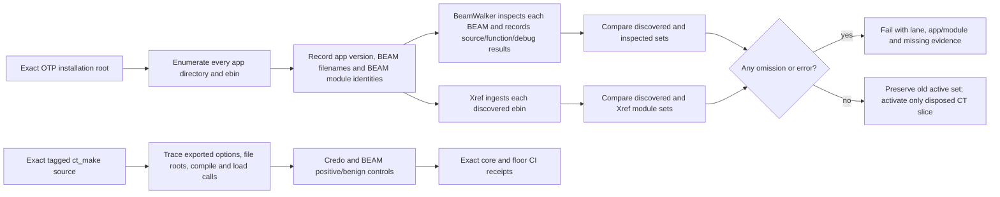

# Phase 01.1.1.2: Installed OTP inventory and Common Test guard slice - Research

**Researched:** 2026-10-30  
**Domain:** Elixir/OTP static security contracts, installed OTP inventory, Common Test source paths  
**Confidence:** HIGH for repository constraints and exact tagged ct_make source; MEDIUM for local cost calibration; exact-lane inventory/source receipts remain unavailable locally.

<user_constraints>
## User Constraints (from CONTEXT.md)

### Locked Decisions

The prior CONTEXT decisions D-01–D-14, adopted SPLIT, current ROADMAP and verification policy already settle the consequential choices. Their relevant portions are carried forward here. No interactive question was needed: implementation mechanics remain delegated, and this capture does not infer new approvals from silence.

### Independent installation inventory

- **D1112-01:** Discover the actual OTP installation on each lane, including applications pruned from Mix's active code path and applications that have not started. Loaded applications, a fixed app count and the existing `@otp_apps` filter cannot define completeness. Retain Elixir application coverage and the production dependency closure derived from project metadata. (Prior D-04.)
- **D1112-02:** Pin evidence to core Elixir 1.20.4 / OTP 29.1.2 and floor Elixir 1.18.5 / OTP 27.3.4.9. Record actual application versions, discovered BEAM identities, source availability, function/match counts and source bytes per lane. Local results and exact-lane CI receipts are separate evidence. (Prior D-09; SPLIT.)
- **D1112-03:** Keep discovered inventory, successfully inspected inventory and active disposition coverage distinct. Discovery/inspection must account for the complete installation; pending semantic audit is an explicit transfer, never a safe exclusion or evidence that the complete guard sweep passes. Existing live sweep coverage cannot shrink. (SPLIT; current phase SC1/SC3.)
- **D1112-04:** Unreadable files, failed Xref ingestion, absent debug information and missing required source analysis must be observable and fatal. An empty result cannot stand in for a failed scan. Omission and synthetic-installation controls must demonstrate rejection. Inspect applications without starting GUI/debugger/Common Test apps or invoking dangerous APIs. (Prior D-05.)

### Common Test caller-file/load path

- **D1112-05:** Follow the actual exported caller-file/load path in exact-lane source. `:ct_make.files(files, [:load])` is the existing concrete detection gap. Judge caller influence and reachable behavior rather than function names; cover wrappers reached within this bounded family. Research establishes the exact exports and traces before planning their dispositions. (Prior D-01–D-04.)
- **D1112-06:** Mirror unsafe fronts in Credo and the BEAM contract, with uncalled direct/capture/apply/generated probes and relevant source-only forms. StrictCtMake must report hits in both layers. Preserve benign controls and existing conservative atom bans. Compiling and inspecting a fixture proves static detection, never runtime atom safety. (Prior D-02/D-03.)
- **D1112-07:** Changed exclusions require substantive cited triples, full changed-family match mappings and an independent nonvacuous removal witness for each retained exclusion on each applicable lane. Preserve original identities. Lane absence requires inventory/export evidence. Do not broaden this into the remaining exclusion audit. (Prior D-06–D-08.)

### Source evidence and bounded delivery

- **D1112-08:** Reuse the approved exact-version source resolver/archive, lock provenance, digest/containment/line checks and offline recurring tests. Inspect source availability across the expanded inventory; the existing archive is not proof that every newly discovered source is present. Report an unavailable prerequisite and propose a compliant resolution during research rather than silently claiming source coverage. The existing archive approval is not a new unlimited storage or network budget. (Prior D-09; INT-20261030-01; SPLIT.)
- **D1112-09:** Start with at most two bounded PR slices, subject to research calibration; this is the inherited split's planning target, not an executable plan. Every phase remains at most five plans/about three working days; each plan has 2–3 tasks, at most five files per task and projected executor context at most 100,000 of 200,000 tokens. Partition by actual module/function/caller chain and measured cost, never row count alone. Split newly reached work before exceeding the budget. Phase structure is already delegated. (SPLIT; INT-20261029-02; ADR 0021.)
- **D1112-10:** Reuse one graph per lane, existing ExUnit/Xref/BeamWalker/Credo infrastructure and small helpers. No new dependency, general audit/taint framework, recurring network fetch, application starts or stale cross-toolchain cache. Keep runtime and mutation backstops with Phase 5. (Prior D-03/D-14; SPLIT.)
- **D1112-11:** Scoped guard PRs remain separate from `lib/`, `.github/`, dependency, lockfile and `.credo.exs` changes. Each merges only with unchanged checks green and exact tested CI links. Preserve the ordinary two-review-pass cap; the prior phase's one-off extra pass does not renew this phase's budget. (Prior D-13; ADR 0021; INT-20261030-03.)

### Existing safety stops and command boundaries

- **D1112-12:** A newly banned `lib/` caller stops affected implementation with its exact MFA, callsite, caller-input trace and triggering guard. Only the owner may select the ADR-backed allowlist or separate-library-PR remedy. Independent work may proceed without claiming closure. (Prior D-11.)
- **D1112-13:** Macro caller-AST classification remains an owner decision in the substantive AST family of 01.1.1.4. Changed Credo explanation wording remains an owner checkpoint in 01.1.1.5. Neither is resolved or brought forward here. (Prior D-10/D-12.)
- **D1112-14:** Automate observable acceptance within the requested step and reuse prior evidence for unchanged behavior. Do not require repeated confirmation to preserve an existing stop. GSD auto-advance stays disabled; this discussion ends with the research/planning command. (AGENTS.md; verification policy; INT-20261029-05.)

### the agent's Discretion

Choose helper boundaries, inventory/report format, omission-control mechanics, source-root discovery, efficient same-lane graph reuse and bounded PR ordering during research/planning. These were delegated in the prior context. Failures should identify the lane, app/BEAM or MFA, missing evidence and corrective action. No product UI or new public API is needed.

### Deferred Ideas (OUT OF SCOPE)

No new capabilities were proposed. Remaining installed front doors, complete exclusion truth, Macro judgment, final unconditional enforcement and changed explanation keep their existing 01.1.1.3–01.1.1.5 owners. Parent verification debt and Phase 5 runtime proofs remain separate. Conditional collision stops remain unresolved until an actual collision receives its owner decision.
</user_constraints>

<phase_requirements>
## Phase Requirements

| ID | Description | Research Support |
|---|---|---|
| SEC-01 | “No `Code.eval*`, no runtime EEx/HEEx compilation, and no `String.to_atom` on input. Credo bans these, and properties plus mutation-proven tests confirm it.” [VERIFIED: `.planning/REQUIREMENTS.md:161`] | This phase advances the static installed-OTP/Common Test coverage only. It does not complete SEC-01; Phase 5 owns runtime and mutation proof. |
</phase_requirements>

## Summary

Use a file-based inventory rooted at the OTP installation, independently of Mix's active code path and loaded-app state. Reuse `SweepEvidence` for app roots, `BeamWalker` for BEAM inspection, Xref for the existing function graph, and the existing Credo/ExUnit contracts. Record separate discovered, successfully inspected, and actively dispositioned sets; compare the full discovered BEAM set against per-directory Xref returns and make every unreadable, missing-debug, failed-ingestion, or missing-source condition fail closed. [VERIFIED: `test/support/sweep_evidence.ex:43-64`; `test/support/beam_walker.ex:4-34`; official OTP `code` and `xref` docs linked below]

Exact tagged OTP source confirms `ct_make` exports `all/0`, `all/1`, `files/1`, and `files/2` on both lanes. The explicit `files(files, [:load])` path reaches compilation and `code:load_abs`; `all/1` accepts caller options and supports `load`/`netload`. The no-option wrappers pass an empty option list, so the explicit load result must not be blindly attributed to them: disposition all four exports through their actual caller and wrapper paths. Mirror only the source-backed unsafe fronts in Credo and the BEAM contract, preserving benign controls and static-only limits. [VERIFIED: exact OTP 29.1.2 and OTP 27.3.4.9 source links below; repository fixture at `test/contract/banned_calls_test.exs:990-992`]

**Primary recommendation:** First implement and measure full installation discovery/inspection while preserving current active sweep coverage; then ship the bounded Common Test static guard with exact source records and positive StrictCtMake hits. Keep pending front-door families transferred to 01.1.1.3. No new package is needed. Exact-lane CI receipts remain a required implementation/merge prerequisite because this workstation lacks both exact OTP pins. [VERIFIED: `.planning/phases/01.1.1.2-installed-otp-inventory-and-common-test-guard-slice/01.1.1.2-CONTEXT.md:23-39`; local tool probe]

## Architectural Responsibility Map

| Capability | Primary Tier | Secondary Tier | Rationale |
|---|---|---|---|
| Installed app/BEAM discovery | Test/contract infrastructure | OTP installation filesystem | Inventory reads installation metadata and BEAM files without starting target apps. |
| Function reachability | Test/contract infrastructure | OTP Xref and BEAM debug data | Reuse the existing per-lane Xref graph and BeamWalker; ingestion parity must be explicit. |
| Common Test caller-file/load guard | Static security contract | Credo source check and compiled-BEAM contract | The source and BEAM layers catch different representations and both must report the named fixture. |
| Exact-source resolution | Test support | Pinned OTP source references | SweepEvidence validates the archive and source citation before resolving installed/archive content. |

## Standard Stack

### Core

| Existing component | Version / scope | Purpose | Why standard |
|---|---|---|---|
| Elixir / Erlang OTP | Core 1.20.4 / 29.1.2; floor 1.18.5 / 27.3.4.9 | The exact runtime lanes | Locked project pins. They are quoted below from the source-of-truth files. |
| ExUnit | Already part of the Elixir test environment | Executable contract tests and synthetic controls | Existing project test framework; no additional test framework is warranted. |
| Xref | Bundled with OTP tools | Function call graph and per-directory module ingestion | Existing graph layer; official API returns either module inventory or an error and documents the no-debug behavior. |
| BeamWalker | Existing `test/support/beam_walker.ex` | Read debug forms/imports and surface no-debug/errors | Existing BEAM parser; avoids loading or executing inspected modules. |
| SweepEvidence | Existing `test/support/sweep_evidence.ex` | Pin runtime/lock/archive provenance and resolve source citations | Existing exact-source resolver and installed app-root map. |
| Credo BannedCalls | Existing `credo/checks/banned_calls.ex` | Static source guard | Existing custom source guard and tier data. |

**Installation:** None. This phase should add no dependencies or framework.

### Verified repository values

These are verbatim discrete values from the source-of-truth files; use them as current baseline evidence, not as future completeness targets.

From `test/contract/tier_sweep_test.exs:11-15`:

    @otp_apps ~w(
      kernel stdlib compiler erts crypto public_key asn1 ssl inets syntax_tools tools parsetools
      runtime_tools sasl dialyzer xmerl os_mon
    )a
    @elixir_apps [:elixir, :eex, :mix, :iex, :logger, :ex_unit]

From `test/contract/tier_sweep_test.exs:2633-2634`:

    for dir <- dirs, do: :xref.add_directory(:tier_sweep, String.to_charlist(dir))
    {:ok, xref_edges} = :xref.q(:tier_sweep, ~c"E")

From `test/contract/banned_calls_test.exs:840,990-992,1137`:

    Fablebook.GuardFixture.StrictCtMake => []
    defmodule Fablebook.GuardFixture.StrictCtMake do
      def run(files), do: :ct_make.files(files, [:load])
    end
    {":ct_make.files(files, [:load])", false}

From `test/support/sweep_evidence.ex:12-24`:

    @archive Path.expand("../fixtures/guards/exact_sources.tar.gz", __DIR__)
    @archive_sha "440acba715d62b116d9fba7baa495ec51e6a556c9cb88f4212a6bfdae2b0fe73"
    @refs %{
      "core" => %{
        "otp" => ["29.1.2", "d199a49a01a2079afb6f2c5c9ae047cd4555e68d"],
        "elixir" => ["1.20.4", "759443e724f55bf58e71c0603644e99058918d52"]
      },
      "floor" => %{
        "otp" => ["27.3.4.9", "4aa809ae4eb4a20ad89c23837376acf179877f39"],
        "elixir" => ["1.18.5", "dfe6612e546cec6557900e67651f7d21805472ef"]
      }
    }

These quotes are `[VERIFIED: test/contract/tier_sweep_test.exs:11-15,2633-2634; test/contract/banned_calls_test.exs:840,990-992,1137; test/support/sweep_evidence.ex:12-24]`. The core pin is also in `.tool-versions:1-2`; the floor pin is in `.github/actions/setup/action.yml:22-28`.

## Architecture Patterns

### Recommended flow

### Pattern 1: Inventory the installation, not the running app set

Scan immediate application roots under the OTP installation library root and find each ebin directory. Read app/version metadata and enumerate BEAM files from disk. For every BEAM, inspect bytes with BeamWalker/beam_lib and retain the module identity from the BEAM itself. Do not use Mix-pruned active code paths, `application:which_applications/0`, loaded-app lists, or a hard-coded application count as the completeness source. The official OTP docs distinguish `$OTPROOT/lib` from code-path state and document application roots as `lib/Application-Vsn` with BEAMs in `ebin`. [CITED: [OTP code module](https://www.erlang.org/doc/apps/kernel/code.html); [OTP application directory structure](https://www.erlang.org/docs/27/system/applications.html)]

`SweepEvidence.source_roots!/0` already scans every OTP library child having ebin and merges it with Elixir apps/dependency roots; it is a better starting point than a second app-list implementation. Extend its measurable output or add a small private helper without creating a general inventory framework. [VERIFIED: `test/support/sweep_evidence.ex:43-64`]

### Pattern 2: Make Xref parity and scan failures observable

The current `build_graph/0` sends each selected ebin to Xref but ignores every result. Its `otp_app_dirs/1` filters installation directories through the quoted `@otp_apps`; `out_of_scope/0` reports extra directories rather than inspecting them. After discovery expands, retain one Xref graph per lane, call Xref for every discovered ebin, collect successful returned module lists, and compare those module identities with the independently enumerated BEAM identities. Treat an error tuple or mismatch as fatal with app/BEAM context. [VERIFIED: `test/contract/tier_sweep_test.exs:2618-2640,2656-2664,2720-2729`]

This is required because OTP Xref `add_directory/2` returns `{:ok, Modules}` or an error, and in functions mode it ignores BEAM files without debug information. A successful empty graph is therefore not a sufficient scan result. Keep BeamWalker no-debug/read errors separately visible and fatal; its existing `scan/1` returns `{:error, :no_debug_info}` for missing debug chunks. [CITED: [OTP 29.1.2 Xref add_directory/2](https://www.erlang.org/doc/apps/tools/xref.html#add_directory); [OTP 27 Xref docs](https://www.erlang.org/docs/27/apps/tools/xref.html); VERIFIED: `test/support/beam_walker.ex:4-34`]

Track three sets separately: discovered apps/BEAM identities; successfully inspected identities with source/debug/function results; active disposition coverage. The active set keeps the existing scope and adds only this phase's source-disposed CT family. Remaining inventory families are explicit pending transfers to 01.1.1.3. This phase must not assert full installed-versus-active equality or zero-undisposed fronts. [VERIFIED: `.planning/phases/01.1.1.2-installed-otp-inventory-and-common-test-guard-slice/01.1.1.2-CONTEXT.md:23-26`; `.planning/ROADMAP.md:223-227`]

### Pattern 3: Use compile-only synthetic omission controls

Add temporary synthetic application/BEAM trees that prove the inventory catches an app outside the old set and fails for missing/corrupt/no-debug BEAMs, an Xref result error, and a discovered-versus-ingested mismatch. Use read-only metadata/BEAM inspection; do not call application start functions, ct_make, compiler output from adversarial fixtures, GUI/debugger apps, or dangerous API fronts. Controls should test diagnostic context (lane, app/BEAM, error/missing evidence), not freeze the current installed app count. [VERIFIED: phase context `01.1.1.2-CONTEXT.md:23-26`; local existing helpers cited above]

### Pattern 4: Source-dispose the actual Common Test chain

The exact tagged sources both declare `-export([all/0,all/1,files/1,files/2]).` (`OTP-29.1.2` line 37; `OTP-27.3.4.9` line 33). In each lane, `files/2` accepts file roots and options, then calls the common make path. `all/1` accepts options and reads Emakefile. `load_opt/1` resolves `netload` before `load`; `do_recompile/4` calls `compile:file/2`, and `maybe_load/3` reaches `code:purge/1` and `code:load_abs/2` for load, or reads a BEAM and sends `code:load_binary/3` through RPC for netload. The default wrappers `all/0` and `files/1` pass an empty option list and resolve to no-load, so their remaining compile/Emakefile semantics need their own explicit evidence rather than inheriting the `[:load]` verdict. [VERIFIED: [OTP 29.1.2 ct_make source](https://github.com/erlang/otp/blob/OTP-29.1.2/lib/common_test/src/ct_make.erl#L32-L69), [load/compile path](https://github.com/erlang/otp/blob/OTP-29.1.2/lib/common_test/src/ct_make.erl#L191-L202); [OTP 27.3.4.9 ct_make source](https://github.com/erlang/otp/blob/OTP-27.3.4.9/lib/common_test/src/ct_make.erl#L30-L65), [load/compile path](https://github.com/erlang/otp/blob/OTP-27.3.4.9/lib/common_test/src/ct_make.erl#L187-L198)]

Do not execute these functions while researching or testing the guard. Update the existing negative StrictCtMake expectations to positive results only after the cited source family and each export's caller influence are recorded. Cover uncalled direct, capture, apply/generated, and source-only shapes in both layers; preserve benign examples. Keep the discovered `common_test` app in inventory/inspection even if only the bounded ct_make family is actively dispositioned. [VERIFIED: `test/contract/banned_calls_test.exs:840,990-992,1137`; `.planning/phases/01.1.1.2-installed-otp-inventory-and-common-test-guard-slice/01.1.1.2-CONTEXT.md:28-32`]

### Source resolver gap and bounded remedy

The current exact-source archive has 223 tar entries and a manifest with 225 source records across core/floor; inspection found no `ct_make` source path in the archive manifest. SweepEvidence requires a manifest row before it checks an installed source path and fails with `:missing_source` when the row is absent. Therefore a CI-installed source file alone cannot currently satisfy a ct_make citation through this resolver. [VERIFIED: local archive listing/manifest inspection; `test/support/sweep_evidence.ex:81-99,185-195`]

Research fetched only the exact upstream files: core `common_test/src/ct_make.erl`, 10,953 bytes, SHA-256 `a6d46d0f31e75119b543ba5783782c7c48b358fa024a71763e5a7f2c6ff4d3a3`; floor same source path, 10,846 bytes, SHA-256 `7f5dce364ae35232780c7904b6e45475aed4ba0d95105ee114f04e992492e62b`. Both carry SPDX Apache-2.0. The concrete compliant candidate is to add just these two exact files and per-lane manifest records through the current test-only archive/resolver, update its digest, verify exact byte/hash/license and offline resolution, and keep recurring tests offline. Their combined uncompressed bytes are 21,799; measure the compressed delta before making the archive change. Do not fetch the whole OTP source tree or assume the existing approval permits unlimited growth. If the exact required sources cannot be obtained, verified, and fit within the bounded archive strategy, stop the source-dependent CT disposition and report the concrete gap; never call it covered. [VERIFIED: exact OTP source bytes/hashes and SPDX headers; archive approval: `.planning/intent/sources/2026-10-30-01-approve-exact-source-archive.md:6,11-13`; source resolver lines above]

### Local calibration (not exact-lane receipts)

Read-only probes enumerated installation directories, counted BEAMs and debug-info function forms, and totaled regular files/bytes beneath app src directories. They read `.app`/BEAM/source files and did not invoke Common Test, start target applications, or run tests. Counts define local calibration only and must not become fixed CI expectations. [VERIFIED: local read-only shell probes]

| Calibration environment | OTP app dirs | BEAMs | Non-`__info__/1` function forms | Missing debug / read errors | Regular app-src files | App-src bytes | ct_make source / functions |
|---|---:|---:|---:|---:|---:|---:|---|
| Local core-like: Elixir 1.20.4, OTP 29.1.1 | 35 | 1,321 | 90,287 | 0 / 0 | 1,567 | 50,501,859 | 10,953 bytes / 29 |
| Local floor-like: Elixir 1.18.4, OTP 27.3.4.15 | 35 | 1,276 | 85,556 | 0 / 0 | 1,521 | 46,414,513 | 10,846 bytes / 29 |

The aggregate function count is a count of debug-info function forms with `__info__/1` excluded, not a semantic unsafe-function count or match count. Local core-like inspection found one app resource and a src directory for each of its 35 directories; this remains adjacent-version calibration. The exact core OTP 29.1.2 and exact floor OTP 27.3.4.9 are not installed, and exact app versions, BEAM identities, debug/source availability, and function/source totals have not been measured. [VERIFIED: local probes; exact pins from `.tool-versions:1-2`, `.github/actions/setup/action.yml:22-28`]

## Don't Hand-Roll

| Problem | Don't build | Use instead | Why |
|---|---|---|---|
| Call-graph and module ingestion | A second graph engine or application-name allowlist | Existing Xref graph, with checked results and module-set parity | It already powers reachability; one graph per lane is locked. |
| BEAM parsing | A new BEAM parser or runtime module loading | BeamWalker and OTP beam_lib debug chunks | Existing parser surfaces imports/forms/no-debug without executing the module. |
| Exact-source trust | A network-fetching test helper or ad hoc source citation | SweepEvidence's pinned, hashed, contained archive resolver | Reuses lock, source identity, digest, line and offline checks. |
| Generic inventory/taint platform | A broad framework | Small private helper/report extension around existing support | The phase is one inventory and one named CT slice; no dependency or framework is approved. |

## Common Pitfalls

1. **Mix-pruned apps disappear.** The present `@otp_apps` list contains a fixed subset and the graph uses that subset to build OTP ebin paths. Scan the installed OTP library tree independently; do not use the current list or a count as completeness. [VERIFIED: `test/contract/tier_sweep_test.exs:11-15,2656-2664`]
2. **Ignored Xref results look like a green scan.** Current code discards the return from every `add_directory`. Match success/error, compare returned modules with disk-discovered BEAM identities, and fail on mismatch. [VERIFIED: `test/contract/tier_sweep_test.exs:2629-2637`; CITED: OTP Xref docs]
3. **Functions-mode Xref silently omits no-debug BEAMs.** BeamWalker must independently report no-debug and read errors; no missing identity can turn into an empty function set. [CITED: OTP 29 Xref docs; VERIFIED: `test/support/beam_walker.ex:7-34`]
4. **Loaded state is not installation state.** `code:all_available/0` is defined in terms of loaded or loadable modules; filesystem enumeration of the OTP root is the completeness basis, while code-server queries may be supplemental diagnostics. [CITED: OTP `code` docs]
5. **The explicit ct_make load option is not wrapper proof.** `files/2` and `all/1` are configurable; `files/1` and `all/0` use empty options. Review each exported wrapper, Emakefile path, and source/file influence before assigning a disposition. [VERIFIED: exact tagged ct_make source]
6. **Archive approval is bounded.** The current manifest has no ct_make record. Add only the exact needed per-lane source files after measuring compressed growth and verifying hashes/licenses; no recurring fetch and no whole-tree archive expansion. [VERIFIED: local archive inspection; approval at `.planning/intent/sources/2026-10-30-01-approve-exact-source-archive.md:6,13`]
7. **Static detection is presented as runtime safety.** Positive Credo/BEAM detections prove only those static forms. Do not claim atom-table or runtime-safety completion; SEC-01 remains pending for Phase 5. [VERIFIED: context `01.1.1.2-CONTEXT.md:30-38`; requirement `.planning/REQUIREMENTS.md:161`]
8. **Inventory expansion becomes semantic completion.** Successfully inspecting a BEAM does not dispose its dangerous fronts. Keep pending families as named transfers to 01.1.1.3 and keep the full equality/zero-undisposed gate with its later owner. [VERIFIED: `.planning/ROADMAP.md:223-227`]

## Code Examples

The Xref ingestion should preserve both success and error outcomes, then compare its modules with the independently scanned BEAM identities:

    case :xref.add_directory(graph, String.to_charlist(ebin)) do
      {:ok, modules} -> compare_discovered_modules!(ebin, modules)
      {:error, module, reason} -> fail_inventory!(lane, app, module, reason)
    end

This is a shape example, not a project function name or implementation contract. The existing call site already converts the directory to a charlist; OTP documents the success/error tuple, and BeamWalker separately reports no-debug and read errors. Do not turn errors into empty collections. [CITED: [OTP Xref add_directory/2](https://www.erlang.org/doc/apps/tools/xref.html#add_directory); VERIFIED: `test/contract/tier_sweep_test.exs:2633-2634`; `test/support/beam_walker.ex:4-34`]

The exact unsafe call already present in the contract fixture is quoted above from `test/contract/banned_calls_test.exs:990-992`. The source trace to keep beside each positive control is: options/file roots → compile path → selected load mode → code load (or remote netload). This is a source-only/static review; no fixture execution is needed. [VERIFIED: exact OTP sources linked under Pattern 4]

## State of the Art

No new library or tool is recommended. OTP 27 deprecates code:lib_dir/2; derive subpaths from code:lib_dir/1 and ordinary path joins if source discovery needs them. The target lanes can use the direct library root from code:lib_dir/0 and the application directory layout, so the deprecated function is unnecessary. [CITED: [OTP 29 code docs](https://www.erlang.org/doc/apps/kernel/code.html); [OTP 27 code docs](https://www.erlang.org/docs/27/apps/kernel/code.html)]

**Deprecated/outdated:** Fixed application allowlists and loaded-app state as a proxy for all installed apps are incompatible with the locked scope; the current tier sweep demonstrates that filter and is the gap this phase closes.

## Assumptions Log

| # | Claim | Section | Risk if wrong |
|---|---|---|---|
| A1 | Exact setup-beam installations expose enough app source on disk for per-app source availability measurement; this must be measured in both exact lanes before claiming completeness. | Environment / inventory | The source measurement/report needs a bounded CI source prerequisite or must mark unavailable apps explicitly. |
| A2 | A two-file source extension fits the existing archive strategy after its compressed-size delta is measured; no such extension was made during research. | Source resolver gap | If it exceeds the owner-approved bounded archive scope, the CT source-backed disposition must stop for scoped approval. |

## Open Questions

All four questions below are **RESOLVED for planning** by the concrete execution contracts stated here. This resolves the method, authority and acceptance boundary; it does not claim unavailable measurements, completed semantic review or a successful archive change. No planning question remains open and no outcome is assumed.

1. **RESOLVED — Exact-lane per-app inventory and source/function totals.** Tasks 01-01/01-02 produce independent disk discovery, checked BEAM/Xref parity and actual per-app source/function/reachability-match/byte measurements; 01-03 extracts and validates complete core/floor JSONL receipts from the unchanged exact CI jobs, and 02-03 refreshes final-head evidence. Authority is inherited D-04/D-05/D-09 and current SC1/SC3: core Elixir 1.20.4 / OTP 29.1.2 and floor Elixir 1.18.5 / OTP 27.3.4.9 are mandatory. Required evidence is actual app versions, every discovered/inspected/ingested identity, source status/count/bytes, distinct function and match totals, complete-record digest, job/run link and tested head. Missing, inconsistent or wrong-lane receipts stop delivery; unreadable/no-debug/ingestion omissions are fatal. The exact totals are intentionally unmeasured until those tasks execute; nearby local totals never substitute.
2. **RESOLVED — Per-app installed source availability.** Task 01-02 measures every discovered app's readable source status, regular-file counts/bytes and BEAM-source mapping availability; 01-03 preserves per-lane results and concrete pending source prerequisites. Authority is D-05/D-09 and the approved bounded resolver strategy: the current archive proves only its declared sources, not installation completeness. Required evidence distinguishes available, absent and unreadable source, with containment and read diagnostics. Unreadable source or missing source required by active/CT semantic analysis stops that affected slice; absence outside current semantic scope stays an explicit prerequisite for its .3 owner and cannot become a safe exclusion or full-source pass. No complete installed source tree is assumed and this resolution authorizes no archive or network expansion.
3. **RESOLVED — Four ct_make export dispositions.** Exact tagged evidence already establishes all/0, all/1, files/1 and files/2 and the option-bearing load/netload routes; tasks 02-01/02-02 perform the bounded implementation source disposition under the already locked D-01/D-02 caller-influence rule, rather than introducing a new policy choice. 02-01 records the files/2 source-to-load trace and positive uncalled source/BEAM detection; 02-02 records each export's actual caller/default/Emakefile/compile path before activating the full family. Required evidence is per-lane immutable source/hash/line traces, independent export/full-match equality, mirrored unsafe-front probes and any retained triple's individual nonvacuous removal witness. The no-option wrappers' final verdict is not presumed from their defaults or from the explicit load branch. Missing source, an undisposed export, an unreviewed coupled path or a failed guard/control stops affected activation/delivery; D-11 library collisions retain the owner-only remedy. No dangerous operation is executed and no semantic outcome is claimed in research.
4. **RESOLVED — Measured two-source archive delta within approval.** Task 02-01 constructs and measures the candidate before replacing the fixture, under INT-20261030-01's existing ordinary-Git exact-source strategy and the current phase's explicit two-file bound. Required evidence is old/new compressed bytes, the known 21,799 raw source bytes, both exact hashes/immutable refs, Apache-2.0 SPDX/license coverage, correct per-lane manifest rows/digest, unchanged existing members and offline resolver checks. Task 02-03 records the measured result. Only the two named ct_make files and their required manifest metadata are covered; unverifiable bytes or any additional source/storage scope stop the source-dependent slice for a concrete owner decision. The compressed delta and successful fit are not yet measured or assumed; recurring fetches and whole-tree expansion remain prohibited.

## Environment Availability

| Dependency/tool | Required by | Available | Version | Fallback |
|---|---|---:|---|---|
| asdf / Elixir | Local calibration | Yes | Elixir 1.20.4 selected; Elixir 1.18.4 available | None for exact-lane proof. |
| Erlang/OTP | Exact per-lane receipts | Partial | Local 29.1.1 and 27.3.4.15; exact 29.1.2 and 27.3.4.9 absent | Use the existing core/floor CI lanes; don't substitute local results. |
| OTP source files | Source/function inventory and ct_make source citation | Partial | Local adjacent-version source present; exact tagged ct_make files fetched for research | Add only exact source rows to the bounded offline archive if approved by measured size. |
| Network | Research fetch only | Available | Two tagged source files requested; no test-time fetch | Recurring network access is prohibited; source tests must remain offline. |
| OTP app starts / CT execution | Not required | Not used | — | Static source and BEAM inspection only. |

**Missing dependencies with no fallback:** Exact OTP lane runtimes are not locally installed; exact-lane validation must occur in existing CI. This does not block planning.

## Validation Architecture

### Test Framework

| Property | Value |
|---|---|
| Framework | ExUnit in the existing Mix test environment |
| Config file | Existing project Mix setup; no new framework configuration |
| Focused command | `mix test --warnings-as-errors test/contract/banned_calls_test.exs test/contract/tier_sweep_test.exs` |
| Core full command | `mix ci` |
| Floor commands | Existing floor CI: warnings-as-errors compile, no-optional-deps compile, and prod-guard tests |

The focused command is the inherited verified command in `01.1.1.1-SPLIT.md:40`. The mix ci alias includes formatting, unused-dependency checks, warnings-as-errors compile, strict Credo, Xref cycle check, docs and tests (`mix.exs:48-58`). Existing paths are `test/contract/tier_sweep_test.exs`, `test/contract/banned_calls_test.exs`, `test/support/beam_walker.ex`, and `test/support/sweep_evidence.ex`. [VERIFIED: cited repository files]

### Phase acceptance → evidence map

| Behavior | Test type | Automated command | Existing evidence / required addition |
|---|---|---|---|
| Full app/BEAM discovery independent of Mix and started apps | Contract | Focused command above; then exact core/floor CI | Extend tier_sweep and reuse SweepEvidence; add synthetic app outside the current list. |
| Fatal unreadable/no-debug/Xref-ingestion omissions | Contract negative controls | Focused command above | Reuse BeamWalker; add corrupt/no-debug/mismatched ingestion controls, with lane/app/BEAM diagnostics. |
| Discovered, inspected and active sets remain distinct | Contract + durable inventory receipt | Focused command above | Preserve existing active coverage; record exact per-lane inventory/source/function evidence for downstream 01.1.1.3. |
| CT caller-file/load path caught by both static layers | Contract | Focused command above, strict Credo via `mix ci` | Change StrictCtMake from negative to positive and add source/BEAM uncalled controls and benign controls. |
| Exact lane behavior | CI integration | Core and floor workflow jobs | No local replacement; preserve exact current-head CI links and unchanged required jobs. |

### Sampling and gaps

- **Per task:** focused contract command after relevant changes.
- **Per PR:** existing full required checks; core uses `mix ci`; floor uses its current compile/prod-guard suite. Keep exact-lane green merge links.
- **Wave 0 gaps:** no test framework install/config gap. New synthetic inventory controls, positive StrictCtMake source/BEAM checks, and two exact-source manifest records are required work. Do not run CT or target application callbacks.
- Research did not run tests. The read-only probes above were calibration, not implementation validation.

## Security Domain

The project has security enforcement enabled at ASVS Level 1 with a high-severity block. The static caller guard and fail-closed evidence checks are relevant to secure-coding controls, but this phase is not an ASVS certification claim and does not complete SEC-01. ASVS 5.0.0 is the current stable version; its V15 category covers secure coding/architecture and identifies dangerous functionality, while V2 addresses validation/business logic. Category identifiers changed from earlier versions, so cite the selected version. [VERIFIED: `.planning/config.json` security settings read this session; CITED: [OWASP ASVS 5.0.0](https://asvs.owasp.org/), [V15 Secure Coding and Architecture](https://github.com/OWASP/ASVS/blob/master/5.0/en/0x24-V15-Secure-Coding-and-Architecture.md), [V2 Validation and Business Logic](https://github.com/OWASP/ASVS/blob/master/5.0/en/0x11-V2-Validation-and-Business-Logic.md)]

### Applicable ASVS categories

| Category | Applies | Phase relevance |
|---|---|---|
| V1 Encoding and Sanitization | Limited | Keep parser/source distinctions; no dynamic runtime evaluation is allowed. |
| V2 Validation and Business Logic | Limited | The inventory must validate evidence completeness and reject omissions; this is a test-contract concern, not user-input validation implementation. |
| V15 Secure Coding and Architecture | Yes | Dangerous code-loading functionality is source-reviewed and protected by mirrored static guards; no direct Level-2 V15.2.5 compliance claim is made. |
| V2/V3 authentication/session, V4 access control, V11 cryptography | No direct application surface in this phase | Not relevant to offline source/BEAM inventory or static call detection. |

### Known threat patterns

| Pattern | STRIDE | Mitigation in this phase |
|---|---|---|
| Caller-controlled file paths/options reach compile/load APIs | Tampering / Elevation of privilege | Source-backed export/caller trace; Credo and BEAM positive uncalled controls; no fixture execution. |
| Missing app/BEAM/debug data makes a graph appear empty | Tampering / Repudiation | Compare independent discovered and inspected/Xref module sets; fatal diagnostics and synthetic omission controls. |
| Static pass is misrepresented as runtime proof | Repudiation | Keep SEC-01 pending; Phase 5 owns runtime atom/eval and mutation proof. |

## Project Constraints (from AGENTS.md)

- Read North-Star, Clearance, Glossary, ADR index and verification policy before planning; researchers also read the seed, ADRs and research notes.
- Apply precedence exactly: verbatim intent > ADR > REQUIREMENTS > PROJECT. Do not reinterpret owner intent.
- Never lower a quality gate; split scope if it cannot fit. No runtime eval and no atoms from input. Prefer copy-paste over a new dependency; adopters do not need Node.
- Every phase ends in a merged green PR with CI evidence linked. Do not edit a contract test in the same PR as `lib/**` or `.github/**` implementation paths, per ADR 0021. Keep this phase's guard slices away from the user-locked paths and `.credo.exs`.
- Do not auto-accept visual baselines. Do not commit PII, email addresses or absolute home paths. Keep code idiomatic and minimal; comments should not restate code.
- Keep communication plain and direct, reuse automated evidence, preserve safety stops without asking again, and end the GSD flow with the next command and its purpose. GSD auto-advance remains disabled.

## Sources

### Primary OTP source and documentation

- [OTP 29.1.2 ct_make.erl, exports and callers](https://github.com/erlang/otp/blob/OTP-29.1.2/lib/common_test/src/ct_make.erl#L32-L69) — exact tagged exports, default wrappers, files/options route.
- [OTP 29.1.2 ct_make.erl, option and load path](https://github.com/erlang/otp/blob/OTP-29.1.2/lib/common_test/src/ct_make.erl#L191-L202) — load/netload selection.
- [OTP 29.1.2 ct_make.erl, compile and load implementation](https://github.com/erlang/otp/blob/OTP-29.1.2/lib/common_test/src/ct_make.erl#L288-L328) — compile:file, code purge/load, RPC netload path.
- [OTP 27.3.4.9 ct_make.erl](https://github.com/erlang/otp/blob/OTP-27.3.4.9/lib/common_test/src/ct_make.erl#L30-L65) and [load implementation](https://github.com/erlang/otp/blob/OTP-27.3.4.9/lib/common_test/src/ct_make.erl#L187-L324) — exact floor tag source.
- [OTP 29 code module](https://www.erlang.org/doc/apps/kernel/code.html) and [OTP 27 code module](https://www.erlang.org/docs/27/apps/kernel/code.html) — installation root, code paths, app roots, and archive considerations.
- [OTP 29.1.2 Xref add_directory](https://www.erlang.org/doc/apps/tools/xref.html#add_directory) and [OTP 27 Xref docs](https://www.erlang.org/docs/27/apps/tools/xref.html) — return/error contract and functions-mode debug behavior.
- [OTP 27 application resource and directory structure](https://www.erlang.org/docs/27/system/applications.html) — app metadata and `lib/Application-Vsn/ebin` layout.
- [Common Test ct module](https://www.erlang.org/doc/apps/common_test/ct.html) — official Common Test interface documentation; exact ct_make behavior was verified from tagged upstream source because the module marks its documentation false.

### Project source of truth

- `.planning/phases/01.1.1.2-installed-otp-inventory-and-common-test-guard-slice/01.1.1.2-CONTEXT.md` and `.planning/ROADMAP.md:218-227` — locked scope, transfers and acceptance boundary.
- `test/contract/tier_sweep_test.exs`, `test/contract/banned_calls_test.exs`, `test/support/sweep_evidence.ex`, `test/support/beam_walker.ex`, and `credo/checks/banned_calls.ex` — current inventory, Xref, resolver and guard behavior.
- `.tool-versions`, `.github/actions/setup/action.yml`, `mix.exs`, `.github/workflows/ci.yml`, and `01.1.1.1-SPLIT.md` — pins and commands.
- [OWASP ASVS 5.0.0](https://asvs.owasp.org/) and its [V15](https://github.com/OWASP/ASVS/blob/master/5.0/en/0x24-V15-Secure-Coding-and-Architecture.md) and [V2](https://github.com/OWASP/ASVS/blob/master/5.0/en/0x11-V2-Validation-and-Business-Logic.md) chapters.

## Metadata

**Confidence breakdown:**
- Standard stack: HIGH — existing repository framework and helper files were read; no package additions are recommended.
- Architecture: HIGH — locked CONTEXT/SPLIT and current implementation seams agree; official OTP docs confirm installation/Xref semantics.
- Common Test source path: HIGH — exact tag source for both target lanes was fetched and inspected.
- Inventory size: MEDIUM for local adjacent-version calibration; LOW/not yet observed for exact-lane full inventory/source receipts.
- Security mapping: MEDIUM — current official ASVS 5.0.0 chapters checked; phase is not an ASVS control-completion claim.

**Research date:** 2026-10-30  
**Valid until:** Recheck only if either exact toolchain pin, OTP API/source tag, resolver, or existing contract test changes.
