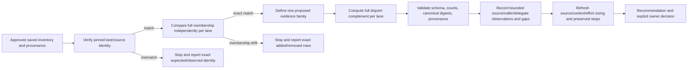

# Phase 7: Guard Scope Reconciliation - Research

**Researched:** 2026-11-19  
**Domain:** Read-only, lane-pinned evidence reconciliation and local artifact validation  
**Confidence:** HIGH for project constraints and artifact patterns; MEDIUM for sizing until current source membership is reconciled

<user_constraints>
## User Constraints (from CONTEXT.md)

### Locked Decisions

## Implementation Decisions

### Membership and lane identity
- Recompute current membership independently for each pinned lane and bind each result to the exact lane/source identity; counts alone do not establish matching inputs.
- Compare the complete relevant surviving row/function set to its saved inventory, report exact differences, and stop on identity or membership drift rather than combining generations.
- Preserve the prior EX-177 four-key and 9,712-row figures as historical evidence only; do not assume they are the current family or complement.

### Proposed family, complement, and claim boundaries
- Name one exact proposed evidence-scope family, clearly distinguish it from a selected/promoted code candidate, and prove the per-lane complement is complete and disjoint with reproducible counts/digests.
- Record only the bounded caller and delegate paths supported by the approved source inspection. Mark dynamic, external, callback, and otherwise unresolved paths as gaps; do not make package-wide or exhaustive caller-absence claims.
- Keep actual-library collision unresolved and retain the owner stop. Candidate remains null; implementation remains unauthorized; the aggregate gate remains open.

### Sizing, checks, and exit
- Refresh source, context, and effort estimates before execution; retain all recorded per-task/per-plan/per-phase limits and do not impose a new assistant-side cumulative token ceiling.
- Prefer a small standard-library-only checker or existing repository tooling; add no dependency or recurring CI job for one evidence reconciliation.
- Run cheap lane-identity, membership, schema, count, and digest checks before any longer review. Stop at the first unexplained mismatch.
- Deliver a reviewable machine-readable reconciliation with a concise human explanation, explicit unknowns, and one recommendation. Stop at the owner decision; do not choose a follow-on increment automatically.

### the agent's Discretion
- Choose the minimal record/checker shape consistent with existing phase evidence, with fields that preserve per-lane provenance, exact membership, complements, gaps, sizing, and open-stop state.
- Choose focused positive and negative controls that prove the new evidence contract without rerunning historical suites or reading outside the authorized source set.
- If a decision would expand source access, change a protected gate, accept candidate fit, or change the next-scope authority, stop and bring the exact decision to the owner.

### Deferred Ideas (OUT OF SCOPE)
- Any next guard increment after this reconciliation; present a recommendation and wait for the owner decision.
- Guard implementation, runtime use, candidate promotion/fit, aggregate closure, and Walking Skeleton work.
- Applied Fablebook/Logistify canon, demo Books and scenarios, a live browser UI, brand asset integration, and dogfood; these remain in the product roadmap behind the typed guard and product prerequisites.
</user_constraints>

<phase_requirements>
## Phase Requirements

| ID | Description | Research Support |
|----|-------------|------------------|
| RSC-01 | The reconciliation records the complete relevant surviving guard row/function membership and exact source identities independently for both pinned lanes, identifies differences from prior saved inventories, and stops for rescoping if source or membership inputs do not match. | Per-lane evidence shape, exact membership comparison and mismatch stop pattern below. |
| RSC-02 | The reconciliation names one exact proposed scope family and records its complete, disjoint complement against the current per-lane membership, with reproducible counts/digests and explicit distinction between a proposed scope and a selected/promoted code candidate. | Set partition, sorted canonical members, counts/digests, and stop-state validation pattern below. |
| RSC-03 | For the proposed family, the evidence records bounded source, caller, and delegate observations with lane identity, provenance, known gaps, and limits; it does not claim exhaustive or package-wide caller closure from bounded/static observations. | Lane-keyed observation/provenance pattern, explicit gaps, and caller-claim boundary below. |
| RSC-04 | The phase refreshes source/context/effort sizing under inherited per-task and per-phase limits, confirms that the evidence is bounded or identifies the reason to stop, preserves every inherited safety stop, and ends with a recommendation plus an explicit owner decision before any further increment. | Sizing ledger, fail-fast check order, preserved stops, and owner-exit recommendation below. |
</phase_requirements>

## Summary

This phase is an evidence reconciliation, not implementation. Plan around three reviewable outputs: a machine-readable per-lane reconciliation, a small one-off local validator, and a concise human decision summary. Phase 3 is the closest precedent for full membership and lane rejoin; Phase 6 is the closest precedent for a strict evidence allowlist, exact record checks, digest validation, and preserved-stop assertions. The archived memberships, keys, lane facts, and digests are shape examples only; they are not Phase 7 inputs or current baselines. [VERIFIED: .planning/phases/07-guard-scope-reconciliation/07-PATTERNS.md:7-15,46-61,168-172]

**Primary recommendation:** Plan fail-fast, lane-independent reconciliation with an explicit source-read allowlist. Validate identities and complete memberships before calculating the new proposed family/complement; preserve every discrepancy and stop for owner rescoping on any unexplained drift. Keep bounded observations and unknowns explicit, refresh sizing from the newly authorized scope, and end with one recommendation and the owner’s next-scope decision. [VERIFIED: .planning/phases/07-guard-scope-reconciliation/07-CONTEXT.md:18-37]

**Scope/stop contract:** Context states: “Do not invoke audited runtime APIs or generated code, consume R9, perform package-wide caller searches, claim exhaustive caller closure, implement guards, promote a candidate, close the aggregate, begin the Walking Skeleton, build product UI/Books, or apply brand sources.” It further requires: “Stop for rescoping if pinned source identity or exact membership does not reconcile.” The owner decides whether another increment is authorized; automatic follow-up remains disabled. [VERIFIED: .planning/phases/07-guard-scope-reconciliation/07-CONTEXT.md:7-11]

## Architectural Responsibility Map

| Capability | Primary Tier | Secondary Tier | Rationale |
|------------|-------------|----------------|-----------|
| Current membership and source-identity reconciliation | Evidence artifact / local planning utility | — | The result is a planning evidence package and local checker; it does not change the library or invoke its runtime. |
| Proposed-family and complete-complement proof | Evidence artifact / local planning utility | — | It is a reproducible data partition bound to each lane’s independently reconciled membership. |
| Bounded caller/delegate observations and gap statement | Evidence artifact | — | Records what authorized static/source inspection observed; it cannot establish exhaustive closure. |
| Next-scope authorization | Owner decision | — | Phase exit is explicitly a decision boundary; no next increment is automatic. |

All responsibilities and boundaries above follow the phase scope and artifacts described in Context and Pattern Map. [VERIFIED: .planning/phases/07-guard-scope-reconciliation/07-CONTEXT.md:7-11,70-81; .planning/phases/07-guard-scope-reconciliation/07-PATTERNS.md:7-15]

## Standard Stack

### Core

| Tool | Version | Purpose | Why Standard |
|------|---------|---------|--------------|
| Python standard library | Python 3.14.4 observed locally; no package dependency | One-off strict JSON/JSONL evidence validator, canonicalization, set partition checks, and SHA-256 digests | Phase 5/6 validators already use Python standard-library patterns; the phase decision explicitly prefers this and disallows a new dependency for this reconciliation. |
| Existing phase evidence and repository tooling | Existing files; inspect exact approved inputs during execution | Saved inventories, lane identity evidence, provenance and gap records | The requirement is a fresh comparison against saved evidence; prior receipts are inputs, never proof that current source has not drifted. |

Source: local `python3 --version` returned `Python 3.14.4`; the phase context says “Prefer a small standard-library-only checker or existing repository tooling; add no dependency or recurring CI job for one evidence reconciliation.” [VERIFIED: local environment; .planning/phases/07-guard-scope-reconciliation/07-CONTEXT.md:28-32]

### Supporting

| Tool | Purpose | When to Use |
|------|---------|-------------|
| SHA-256 from the standard library | Reproducible digests of canonical membership/complement records and raw evidence where that is the established encoding | Compute only after lane identity and membership checks pass; document the canonical byte/string recipe beside every digest. |
| Strict JSON/JSONL parsing | Reject malformed or ambiguous evidence records, duplicate keys, blank rows, and unexpected shapes | Before comparing identities, sets, counts, or digests. |

The archived Phase 6 checker uses Python `hashlib`/`json`, a `read_input` allowlist, and duplicate-object-key rejection. [VERIFIED: .planning/milestones/v0.5-phases/06-bounded-ex-177-provenance-supplement/06-validate-supplement.py:1-8,20-30; .planning/phases/07-guard-scope-reconciliation/07-PATTERNS.md:86-103]

### Alternatives Considered

| Instead of | Could Use | Tradeoff |
|------------|-----------|----------|
| Small phase-local Python standard-library validator | Existing repository Elixir tooling | Existing tooling is acceptable if it can preserve explicit file allowlists, strict schema parsing, reproducible digests and focused negative controls with equal clarity; avoid introducing a dependency or recurring CI lane for this one-off reconciliation. |
| Full package-wide or runtime caller discovery | Bounded, provenance-linked source/caller/delegate observations | Broader discovery exceeds phase authorization and can imply completeness that static/dynamic analysis does not establish. |

These are scoped choices from the phase context; do not expand source access or run audited APIs to choose between them. [VERIFIED: .planning/phases/07-guard-scope-reconciliation/07-CONTEXT.md:7-11,28-37]

**Installation:** None. No external package is required or recommended. Package-legitimacy review is not applicable because this phase does not install packages. [VERIFIED: .planning/phases/07-guard-scope-reconciliation/07-CONTEXT.md:28-32; .planning/REQUIREMENTS.md:38-54]

## Architecture Patterns

### System Architecture Diagram



This is evidence/data flow, not a repository file map. The required order and stop branches are grounded in the phase’s cheapest-checks-first and no-mixed-generations rules. [VERIFIED: .planning/phases/07-guard-scope-reconciliation/07-CONTEXT.md:18-32; .planning/phases/07-guard-scope-reconciliation/07-PATTERNS.md:162-172]

### Recommended Project Structure

```text
.planning/phases/07-guard-scope-reconciliation/
├── 07-RECONCILIATION.json       # per-lane membership, identity, partition, observations, stops
├── 07-validate-reconciliation.py # local standard-library checker with explicit inputs
└── 07-RECONCILIATION.md         # readable result, limitations, sizing, recommendation
```

These are suggested artifact names from the Pattern Map, not existing paths or fixed schema commitments; planner may combine the checker summary and human result if still reviewable. [VERIFIED: .planning/phases/07-guard-scope-reconciliation/07-PATTERNS.md:7-15]

### Pattern 1: Lane-First Exact Reconciliation

**What:** Keep independent lane records with source identity and membership; compare each lane only to its own saved inventory. Record exact additions/removals, not just counts. Only after the identity and full membership match should planning compute the proposed family and complement. [VERIFIED: .planning/phases/07-guard-scope-reconciliation/07-CONTEXT.md:18-21; .planning/phases/07-guard-scope-reconciliation/07-PATTERNS.md:44-61,105-125]

**When to use:** Every lane, including when two lanes happen to report identical counts or source hashes. Counts alone do not establish matching inputs. [VERIFIED: .planning/phases/07-guard-scope-reconciliation/07-CONTEXT.md:18-20]

**Example:**

```python
assert observed_source_identity[lane] == saved_source_identity[lane]
assert observed_membership[lane] == saved_membership[lane]
assert selected[lane].isdisjoint(complement[lane])
assert selected[lane] | complement[lane] == observed_membership[lane]
```

The operations are an abstract pattern; do not copy prior phase identities, counts, selected keys or hashes into these comparisons. [VERIFIED: .planning/phases/07-guard-scope-reconciliation/07-PATTERNS.md:7,61,125,160]

### Pattern 2: Explicit Evidence Read Boundary

**What:** Validator reads only a small, named allowlist of saved evidence. Any target source paths in the record are values for provenance, not paths that the validator opens. Reject duplicate JSON keys, malformed rows, and unexpected schema keys before semantic checks. [VERIFIED: .planning/phases/07-guard-scope-reconciliation/07-PATTERNS.md:86-103; .planning/milestones/v0.5-phases/06-bounded-ex-177-provenance-supplement/06-validate-supplement.py:20-30]

**When to use:** All validator reads and all recorded source/caller evidence. Any requested input outside the reviewed allowlist requires a stop and exact owner decision, not an implicit read expansion. [VERIFIED: .planning/phases/07-guard-scope-reconciliation/07-CONTEXT.md:34-37; .planning/phases/07-guard-scope-reconciliation/07-PATTERNS.md:44,103]

### Pattern 3: Bounded Claims and Preserved Stops

**What:** Link each observation to lane and source evidence; list unobserved dynamic, external, callback, and unresolved delegate/caller paths as gaps. Context states: “Keep actual-library collision unresolved and retain the owner stop. Candidate remains null; implementation remains unauthorized; the aggregate gate remains open.” [VERIFIED: .planning/phases/07-guard-scope-reconciliation/07-CONTEXT.md:23-26; .planning/phases/07-guard-scope-reconciliation/07-PATTERNS.md:63-80,127-137]

**When to use:** Human report, machine record, checker assertions and recommendation. A proposed evidence family is not candidate fit, candidate promotion, or aggregate closure. [VERIFIED: .planning/phases/07-guard-scope-reconciliation/07-CONTEXT.md:9-11,23-27]

### Anti-Patterns to Avoid

- **Use old counts as current scope:** Prior EX-177 figures are historical only. Context says: “Preserve the prior EX-177 four-key and 9,712-row figures as historical evidence only; do not assume they are the current family or complement.” [VERIFIED: .planning/phases/07-guard-scope-reconciliation/07-CONTEXT.md:18-21]
- **Combine mismatched source generations:** Stop when either lane identity or exact membership differs. Never merge inventories because counts appear compatible. [VERIFIED: .planning/phases/07-guard-scope-reconciliation/07-CONTEXT.md:18-20]
- **Infer caller completeness:** Observed paths are bounded evidence. Dynamic calls, external callers, callbacks and unresolved delegates remain gaps; do not claim package-wide/exhaustive absence. [VERIFIED: .planning/phases/07-guard-scope-reconciliation/07-CONTEXT.md:23-26]
- **Read target paths implicitly:** Recorded source paths do not become checker reads; restrict reads to the explicit evidence allowlist. [VERIFIED: .planning/phases/07-guard-scope-reconciliation/07-CONTEXT.md:74-77; .planning/phases/07-guard-scope-reconciliation/07-PATTERNS.md:86-103]
- **Turn evidence into authorization:** The preserved stop state is not changed by a completed reconciliation; end at the owner’s decision. [VERIFIED: .planning/phases/07-guard-scope-reconciliation/07-CONTEXT.md:23-37]

## Don't Hand-Roll

| Problem | Don't Build | Use Instead | Why |
|---------|-------------|-------------|-----|
| JSON parsing ambiguity | Bespoke parser or permissive duplicate-key handling | Python standard-library JSON parser with duplicate-key rejection and explicit schema checks | Prior checker pattern already covers strict parsing and duplicate-key rejection; ambiguity would undermine evidence consistency. |
| Membership reconciliation | Count-only comparison or hand-maintained selected/complement rows | Exact per-lane canonical sets, exact added/removed lists, disjointness and union checks | Equal counts can hide different membership; set equality proves complete partition. |
| Evidence input selection | Broad directory walks or target-path file reads | Explicit fixed input allowlist | Keeps the source-read boundary reviewable and avoids accidental source/caller scope expansion. |
| Hashing | Custom digest algorithm | Standard-library SHA-256 over a documented canonical byte sequence | Existing phase evidence uses reproducible hashes; the encoding recipe must be specified so independent checks agree. |

The archived validators demonstrate these patterns, and Phase 7 explicitly requires a small stdlib-only checker, exact set reconciliation and a source-read allowlist. [VERIFIED: .planning/phases/07-guard-scope-reconciliation/07-CONTEXT.md:28-32,74-77; .planning/phases/07-guard-scope-reconciliation/07-PATTERNS.md:86-125]

**Key insight:** Freshness is established by binding the present evidence to exact per-lane identity and full membership. Historical receipt equality, counts, or matching aggregate digests alone cannot authorize combining evidence from different generations. [VERIFIED: .planning/phases/07-guard-scope-reconciliation/07-CONTEXT.md:18-21; .planning/phases/07-guard-scope-reconciliation/07-PATTERNS.md:44-61,168-172]

## Common Pitfalls

### Pitfall 1: Lane identity checked after counts

**What goes wrong:** A lane mismatch can be hidden by matching counts, leading to mixed-generation evidence.  
**Why it happens:** Counts are easy to compare and can appear to confirm identity.  
**How to avoid:** Validate exact pinned lane and source identity before reading membership differences or computing counts/digests.  
**Warning signs:** A count is accepted without lane-specific source provenance, or records combine data from both lanes. [VERIFIED: .planning/phases/07-guard-scope-reconciliation/07-CONTEXT.md:18-20; .planning/phases/07-guard-scope-reconciliation/07-PATTERNS.md:105-125]

### Pitfall 2: Partition proves only a count

**What goes wrong:** The proposed family/complement can omit a member or overlap while totals still look plausible.  
**Why it happens:** Count checks do not assert set membership.  
**How to avoid:** For each lane independently prove selected and complement are disjoint and their union equals the full current relevant membership; store sorted members and reproducible count/digest pairs.  
**Warning signs:** No complete member list, exact additions/removals, or set equality assertion. [VERIFIED: .planning/phases/07-guard-scope-reconciliation/07-PATTERNS.md:46-61,105-125,147-160]

### Pitfall 3: Bounded source evidence is described as exhaustive

**What goes wrong:** A small direct-call observation is misrepresented as all callers/delegates being known.  
**Why it happens:** Static observations do not capture all dynamic, external, callback, or unresolved paths.  
**How to avoid:** State the search boundary and source provenance beside every observation; enumerate known gaps and avoid exhaustive/package-wide claims.  
**Warning signs:** “No callers” or “all delegates” without explicit scope and proof. [VERIFIED: .planning/phases/07-guard-scope-reconciliation/07-CONTEXT.md:23-26; .planning/research/2026-11-19-v0.6-guard-scope-reconciliation.md, “Stakeholder and adversarial synthesis”]

### Pitfall 4: Continue after unexplained drift

**What goes wrong:** Evidence from incompatible generations gets merged or an invalid partition is still reviewed.  
**Why it happens:** Teams may try to recover by rerunning a broader analysis.  
**How to avoid:** Stop at first unexplained mismatch; record lane, exact expected value, exact observed value and affected evidence; request rescoping before any new source access or partition calculation.  
**Warning signs:** The plan retries against “latest” sources or combines current and saved inventories. [VERIFIED: .planning/phases/07-guard-scope-reconciliation/07-CONTEXT.md:18-20,31-37; .planning/phases/07-guard-scope-reconciliation/07-PATTERNS.md:162-172]

## Sizing and Cheapest Checks

The plan must refresh source, context and effort estimates before execution. Historical scope envelope, verbatim from the upstream phase synthesis: “up to 100,000 planning tokens; at most five exact source files per task; 2–3 tasks per plan; at most five plans per phase; roughly three working days per plan.” Reconfirm those limits in the reviewed plan; do not substitute the historic Phase 6 source-read limit or add an assistant-side cumulative token cap. [VERIFIED: .planning/research/2026-11-19-v0.6-guard-scope-reconciliation.md, “Scope contract for v0.6 / Phase 7”; .planning/phases/07-guard-scope-reconciliation/07-CONTEXT.md:28-30]

Recommended low-cost check order:

1. Confirm each lane’s pinned runtime/dependency/source identity and exact source identity evidence; if a mismatch appears, stop before membership work.
2. Parse approved saved inputs strictly; reject duplicate keys, malformed/blank rows and unexpected fields.
3. Compare complete current per-lane membership with that lane’s saved inventory; record exact additions/removals and stop on drift.
4. Only on matching identities and membership, calculate one proposed family and its complement independently per lane. Verify full member lists, disjointness, union, counts and canonical digests.
5. Validate lane-bound observation references, explicit gaps, sizing and every preserved stop; run focused positive/negative controls against malformed record, lane swap, missing/extra member, overlap, count/digest drift, and mutated stop state.
6. Write the human result with one recommendation and stop for the owner’s next-scope decision.

This order is the Phase 7 pattern-map recommendation. If an early invariant fails, report exact expected and observed values, identify the affected lane/input, and stop. Do not “repair” the record by mixing generations, run a broader caller search, invoke audited/runtime paths, consume R9, or calculate a fresh selected/complement partition from unresolved inputs. [VERIFIED: .planning/phases/07-guard-scope-reconciliation/07-PATTERNS.md:125-137,162-172; .planning/phases/07-guard-scope-reconciliation/07-CONTEXT.md:7-11,31-37]

## Validation Architecture

### Test Framework

| Property | Value |
|----------|-------|
| Framework | No new test framework; phase-local validator can use Python standard library |
| Config file | None for the one-off evidence checker |
| Quick run command | `[ASSUMED]` After the planned checker is created: `python3 .planning/phases/07-guard-scope-reconciliation/07-validate-reconciliation.py` |
| Full suite command | No phase-specific full suite; existing project CI remains governed by the eventual implementation plan and delivery gate |

Do not run implementation tests as part of this research task. The plan should use the local validator’s normal pass plus focused negative controls, not rerun historical suites simply to validate this evidence record. This follows the project’s cheapest-evidence-first policy and phase-specific instruction to avoid rerunning historical suites. [VERIFIED: .planning/VERIFICATION.md, “Automation-first verification defaults”; .planning/phases/07-guard-scope-reconciliation/07-CONTEXT.md:34-36]

### Phase Requirements → Check Map

| Req ID | Behavior | Test Type | Automated Command | File Exists? |
|--------|----------|------------|-------------------|-------------|
| RSC-01 | Identity and complete membership match independently per lane, with exact diffs | Local artifact validator | `python3 .planning/phases/07-guard-scope-reconciliation/07-validate-reconciliation.py` | No; plan creates it |
| RSC-02 | Proposed family and full complement are complete, disjoint, and reproducible per lane | Local artifact validator | Same command; include altered-member, overlap and digest negative controls | No; plan creates it |
| RSC-03 | Observations retain lane/provenance and gaps; no exhaustive caller claim | Local artifact validator plus bounded human review of claims | Same command; mutate a stop/claim in a fixture and verify rejection | No; plan creates it |
| RSC-04 | Refreshed sizing and all stops appear; recommendation ends at owner decision | Artifact validation and owner judgment at exit | Same command plus phase review | No; plan creates it |

The requirements’ exact IDs are “RSC-01”, “RSC-02”, “RSC-03”, and “RSC-04”; each is mapped to Phase 7. [VERIFIED: .planning/REQUIREMENTS.md:8-21]

### Sampling Rate

- **Per artifact change:** run the local validator.
- **Before longer review:** run lane identity/schema/membership/count/digest checks first, then bounded observation checks.
- **Phase gate:** review the full machine-readable record, human summary, source bounds, sizing, stops, and recommendation before owner decision.

### Wave 0 Gaps

- [ ] Create the Phase 7 reconciliation record, local validator, and readable result (the planner may combine checker summary/result if reviewability is preserved).
- [ ] Define the exact canonical serialization/digest recipe and explicit allowlist from the reviewed execution context before generating hashes.
- [ ] Add focused negative controls for identity drift, membership add/remove, partition overlap/omission, count/hash drift, caller-exhaustiveness overclaim, and preserved-stop mutation.

## Security Domain

Security enforcement is enabled in project config, which states `"security_enforcement": true`. The phase changes only evidence artifacts and a local checker; applicable controls focus on evidence input integrity and strict claim boundaries. It must preserve ADR 0004’s no-eval/no-input-derived-atoms rule and must not invoke runtime APIs. [VERIFIED: .planning/config.json:48-51; docs/adr/0004-no-eval-no-new-atoms.md; .planning/phases/07-guard-scope-reconciliation/07-CONTEXT.md:7-11]

### Applicable ASVS Categories

| ASVS Category | Applies | Standard Control |
|---------------|---------|-----------------|
| V2 Authentication | No | No authentication surface is added or changed. |
| V3 Session Management | No | No session behavior is added or changed. |
| V4 Access Control | Yes, evidence boundary only | Fixed input allowlist; reject unapproved reads and never convert recorded target paths into filesystem reads. |
| V5 Input Validation | Yes | Strict JSON/JSONL parsing, duplicate-key rejection, schema allowlist, exact typed comparisons and fail-closed mismatch handling. |
| V6 Cryptography | Limited | Use SHA-256 only for reproducible evidence digests; do not treat hashes as signatures, authenticity proof, or a resolution of collision risk. |

V4/V5/V6 applicability is a phase-specific assessment `[ASSUMED]`, not a new security acceptance claim. The project’s explicit no-eval rule is: “No runtime eval, no atoms created from input, ever.” [VERIFIED: docs/adr/0004-no-eval-no-new-atoms.md, “Decision”; .planning/phases/07-guard-scope-reconciliation/07-PATTERNS.md:86-103]

### Known Threat Patterns for Evidence Reconciliation

| Pattern | STRIDE | Standard Mitigation |
|---------|--------|---------------------|
| Evidence path causes unintended source read | Information disclosure / elevation of scope | Fixed allowlist; recorded target paths are inert data values. |
| Duplicate or malformed JSON changes interpretation | Tampering | Strict parser, duplicate-key rejection, exact schema and fail closed. |
| Lane swap or mixed-generation membership | Tampering / repudiation | Verify identity before membership; keep lane-specific inventories and exact diffs. |
| Digest presented as proof of authenticity or safety | Spoofing | Define digest recipe, bind it to provenance, and retain unresolved collision/owner stop. |
| Caller observations are overstated as complete | Information disclosure / assurance failure | Bounded claim wording; explicit dynamic/external/callback/delegate gaps. |

## Assumptions Log

| # | Claim | Section | Risk if Wrong |
|---|-------|---------|---------------|
| A1 | The Python 3 standard-library checker remains the smallest clear implementation at execution time. | Standard Stack | If the current checked-out repository tooling offers a simpler equally bounded validator, the planner may choose it without adding dependencies. |
| A2 | The suggested quick command is appropriate after the checker exists. | Validation Architecture | The plan may use another local entry point if that preserves the same bounded validation. |
| A3 | The requirement-level focused negative controls can run locally against temporary in-memory or disposable fixtures without touching saved receipts. | Validation Architecture | A control implemented against mutable source artifacts could corrupt historical evidence; constrain fixtures and preserve original bytes. |
| A4 | Phase 7 can be split across the three suggested artifact roles while staying within inherited source/effort bounds; final effort cannot be established before exact current membership is reconciled. | Summary / sizing | Actual inventory size or source-read cost may exceed the envelope; stop and request rescoping rather than truncating. |

## Open Questions

1. **What exact family should be proposed after the two current lane inventories reconcile?**
   - What we know: Phase 7 requires one exact evidence-scope family, with a complete per-lane complement.
   - What is unclear: current membership and exact per-member evidence cost have not been recomputed in this research pass.
   - Recommendation: resolve only in the reviewed execution plan/task under approved source bounds; do not copy Phase 5/6 EX-177 selection as current.
2. **Do current source identity or membership differ from preserved inventories?**
   - What we know: saved artifacts provide the comparison pattern, not a current freshness guarantee.
   - What is unclear: execution-time identity and complete membership.
   - Recommendation: perform identity first, exact membership second, and stop at first unexplained mismatch for owner rescoping.
3. **Which bounded caller/delegate observations are supportable within the source allowlist?**
   - What we know: dynamic, external, callback and unresolved paths must remain explicit gaps.
   - What is unclear: exact observations for the proposed current family.
   - Recommendation: record only evidence supported by authorized source inspection; do not perform package-wide caller search or claim exhaustive closure.

## Environment Availability

| Dependency | Required By | Available | Version | Fallback |
|------------|------------|-----------|---------|----------|
| Python 3 | Local one-off evidence validator | ✓ | 3.14.4 | Existing repository tooling, only if equally bounded and no new dependency is needed |

**Missing dependencies with no fallback:** None identified.  
**Missing dependencies with fallback:** None identified.  

The only external executable needed by the recommended validation approach is Python 3; its version was checked locally. No package installation is proposed. [VERIFIED: local environment; .planning/phases/07-guard-scope-reconciliation/07-CONTEXT.md:28-32]

## Sources

### Primary (HIGH confidence)

- `.planning/phases/07-guard-scope-reconciliation/07-CONTEXT.md` — locked phase boundary, stops, identity/membership rules, checker expectations and discretion.
- `.planning/phases/07-guard-scope-reconciliation/07-PATTERNS.md` — Phase 3/6 artifact shapes, check order, explicit allowlist, partition and negative-control patterns.
- `.planning/REQUIREMENTS.md` and `.planning/ROADMAP.md` — RSC-01–RSC-04 acceptance and phase exit criteria.
- `.planning/milestones/v0.5-phases/06-bounded-ex-177-provenance-supplement/06-validate-supplement.py` and `06-VALIDATION.md` — standard-library validator, strict evidence input boundary, digest and preserved-stop patterns.
- `.planning/milestones/v0.4-phases/03-guard-aggregate-scope-rejoin-and-candidate-sizing/03-03-KEYED-EVIDENCE.json` and `03-PATTERNS.md` — full membership and lane rejoin precedent.
- `.planning/milestones/v0.4-phases/04-evidence-only-source-and-gap-provenance-closure/04-TYPED-GAPS-ENV06.jsonl` and `04-PROVENANCE-MANIFEST.json` — provenance and typed-gap precedent.
- `.planning/research/2026-11-19-v0.6-guard-scope-reconciliation.md` — selected scope, inherited bounds and unresolved product/safety state.
- `docs/adr/0004-no-eval-no-new-atoms.md`, `docs/adr/0021-delivery-rules.md`, `.planning/VERIFICATION.md` — non-negotiable security, size/delivery gates and cheapest-check policy.

No new external documentation lookup was needed; upstream synthesis already cites the primary OTP xref and Mix dependency documentation, and this research task is focused on planning artifact shape and local evidence checks. [VERIFIED: .planning/phases/07-guard-scope-reconciliation/07-CONTEXT.md:61-64; .planning/research/2026-11-19-v0.6-guard-scope-reconciliation.md, “Primary technical sources”]

## Metadata

**Confidence breakdown:**
- Standard stack: HIGH — local Python version observed and existing phase validators use standard library; no new dependency is warranted.
- Architecture: HIGH — phase context and pattern map directly specify evidence artifact roles and stop order.
- Pitfalls: HIGH — derived from locked identity, membership, source-read, and caller-claim constraints.
- Execution sizing: MEDIUM — inherited limits are known, but actual current membership/effort are intentionally unresolved until the approved execution stage.

**Research date:** 2026-11-19  
**Valid until:** Until Phase 7 execution begins or relevant saved evidence/phase context changes; recheck inputs and identities at execution time.
